# How this video was made: pin.mp4

**In one line**: A 28-second looping product-range ad for 'Just the Fun Part' chocolate-filled mini waffle cones: four flavour cards built on one template, ending with the slogan 'Only The Best Part Of The Sundae Cone
**How it was made**: code / template render 100%

- 0:27 · vertical 9:16 · 5 shots, 5.6s each on average
- Confidence 86%, based on: tool measurements + AI assistant reviewed 5 shots
- ⚠️ 3 points are uncertain, see “Open questions”

<!--mix-->

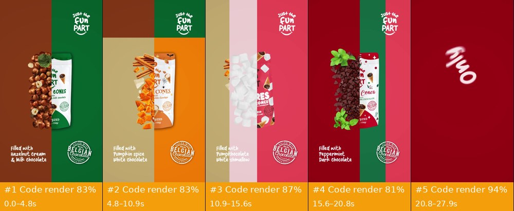

# Part one · Breakdown: how this video is built

## What makes it work

- **The hook**: 0-1 s: no intro; the first frame is already a full product card (hazelnut pile + pouch on brown/green) with 'Filled with Hazelnut cream & Milk chocolate' readable at once.
- One template, four colourways (0-20.8 s): only the colours, ingredient pile and pouch change, so viewers compare flavours at a glance and the production cost is minimal.
- Ingredient-first composition in every card: the raw ingredients (hazelnuts, pumpkin and cinnamon, marshmallows, mint and dark chocolate) sit next to the pack and sell the taste before the packaging do
- Pouch slides out from behind the colour seam (e.g. 1.4-3.7 s): a simple mask trick that gives depth and motion without any 3D.
- Seamless loop (27.7-27.88 s): the end card wipes straight back into the first frame, so on autoplay feeds the ad replays without a visible restart.

## At a glance: picture, packaging, sound

Any short video splits into three layers: the picture, what is laid on top of it (subtitles, styled text, stickers), and the sound. Remake it one layer at a time.

| Layer | In this video | How to make it | Detail |
|---|---|---|---|
| **Picture** (base) | code / template render 5 shots | screen recording / motion graphics in code | “Remake it yourself” |
| **Packaging** (on top) | none | — | “Packaging layer” |
| **Sound** | music (120 BPM, to confirm), 8 distinct effects (9 hits) | music: find a track with the same tempo and mood; effects: add from a library at the listed times | “Sound” |

## Content and structure

- The narrative line below comes from reading each shot; the lines were not transcribed separately, subtitle text is under “Packaging layer”

**Narrative line**

Keep this line in a remake: same order, same job at each step, with the point refilled from your own cases, numbers and material, so it is more than a change of subject.

| Time | Shots | Job | What it says |
|---|---|---|---|
| 0.0–4.8s | #1 | grab attention | Open straight on the product and its first flavour, with no intro, so the viewer sees what is being sold within the first second |
| 4.8–20.8s | #2–#4 | add information | Show the second flavour with the same layout, swapping only the colours and the ingredient pile → Third flavour in the same template; the repetition builds a 'range' feeling → Fourth and last flavour, the seasonal/holiday variant |
| 20.8–27.9s | #5 | deliver the conclusion | Close on the brand promise as one punchy slogan, then loop back to the start so it replays endlessly |

## Shot list

| # | Frame | Time | What it says | Picture | Camera |
|---|---|---|---|---|---|
| 1 | 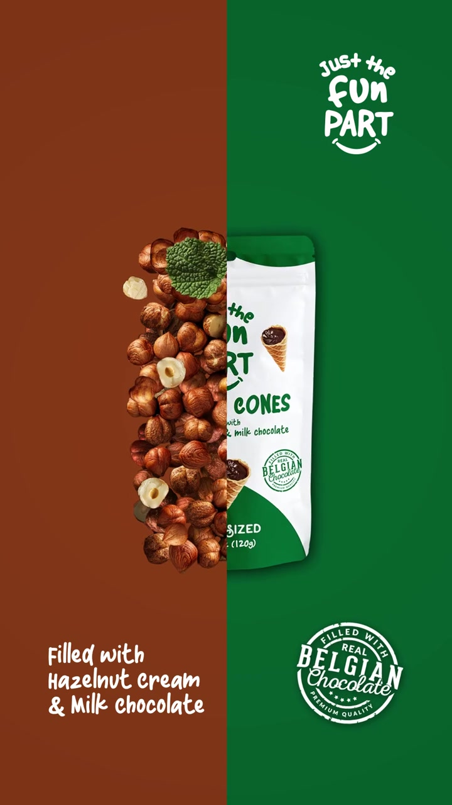 | 0:00.0 · 4.8s | grab attention: Open straight on the product and its first f… | Split-screen product card for the 'Hazelnut cream & milk cho… | static (subject moves) |
| 2 | 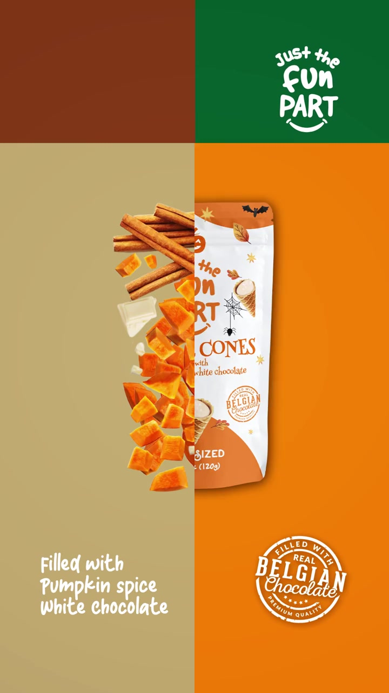 | 0:04.8 · 6.1s | add information: Show the second flavour with the same layou… | Split-screen product card for the 'Pumpkin spice white choco… | static (subject moves) |
| 3 | 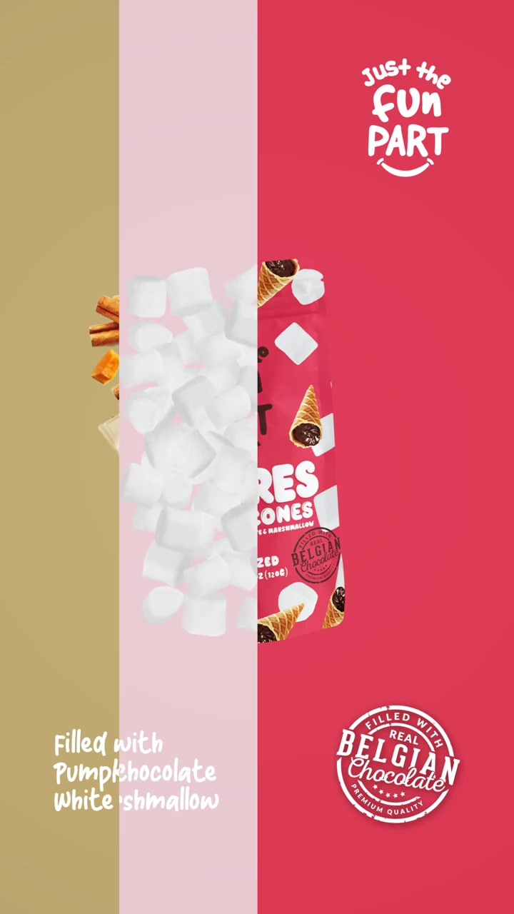 | 0:10.9 · 4.8s | add information: Third flavour in the same template; the rep… | Split-screen product card for the 'Dark chocolate & marshmal… | static (subject moves) |
| 4 | 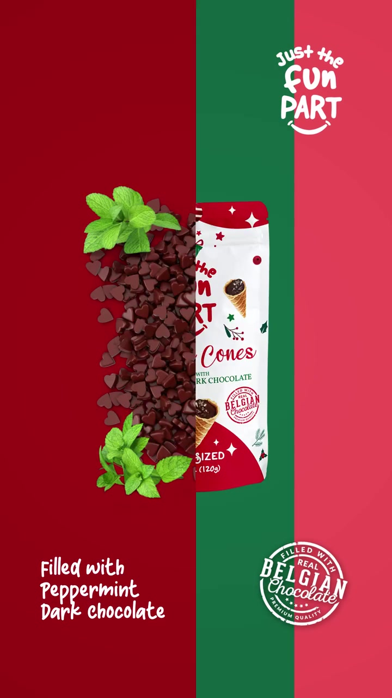 | 0:15.6 · 5.2s | add information: Fourth and last flavour, the seasonal/holid… | Split-screen product card for the 'Peppermint dark chocolate… | static (subject moves) |
| 5 | 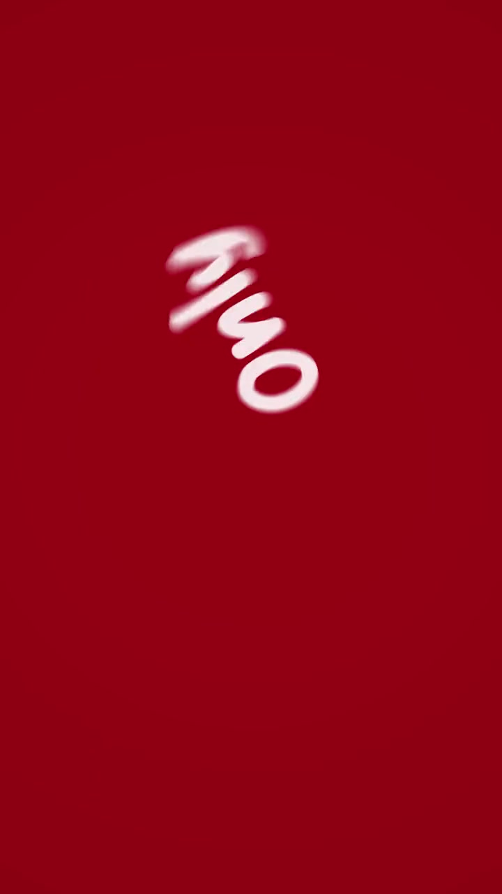 | 0:20.8 · 7.0s | deliver the conclusion: Close on the brand promise as one pu… | End card / slogan. Starts with the peppermint scene being wi… | static (subject moves) |

## Cast, scenes and props

| Id | Name | Kind | Look | Role | Voice | Shots |
|---|---|---|---|---|---|---|
| A | 'Just the Fun Part' Waffle Cones pouch | product | Stand-up snack pouch (about 4.2 oz / 120 g, 'bite-sized'), mini sundae-cone illustrations, flavour-specific colourway: white/green (hazelnut), white/orange Halloween (pumpkin spice), red S'mores, white/red Christmas (peppermint) | hero product | — | #1–#4 |

**Scenes**

| Scene | Where | When | Set / light | Shots |
|---|---|---|---|---|
| S1 | Flat split-colour background (two vertical panels) | n/a | Colour pair changes per flavour: brown/green, tan/orange, pink/coral, dark red/green | #1–#4 |
| S2 | Solid deep-red end card | n/a | Single flat red with white kinetic type | #5 |

**Props / products / logos**

- Ingredient piles (shots #1–#4): Hazelnuts and leaves; pumpkin cubes, cinnamon sticks and white chocolate; marshmallows; dark chocolate shards and mint
- 'Real Belgian Chocolate' badge + 'Just the Fun Part' logo (shots #1–#5): persistent brand overlays

## Camera and lighting

- Visual style: Flat two-tone colour blocking, cut-out product and ingredient photography, white rounded hand-lettered type; bold seasonal palettes.
- Lighting: Not applicable (flat colour panels); product cut-outs carry their own studio packshot lighting: soft, even, front-lit. (image reading; pixel measurements in the fold below)

## Packaging layer (subtitles / styled text / stickers / sound-effect hits)

- 11 subtitle lines (bottom, up to 3 rows): white text, line height 3.8%; entrance: hard in×2, fade in×2, type-on×1
- SFX hits on: subtitle in ×3, cut ×1

text timeline (11 rows)

| Time | Kind | Text | Style | In / out | SFX |
|---|---|---|---|---|---|
| 0.00–4.80s | subtitle | Filled with ⏎ Hazelnut cream ⏎ & Milk ch | white text, line height 3.8% (about 49px) | hard out | whoosh |
| 0.50–4.60s | subtitle | Chocolate | white text, green outline, line height 4.8% (about 62px) | hard in / hard out | — |
| 4.00–6.60s | subtitle | White chocolate | white text, line height 3.2% (about 41px) | — | — |
| 5.00–10.60s | subtitle | Filled with ⏎ Pumpkin spice ⏎ White choc | white text, line height 3.8% (about 48px) | type-on | pop |
| 6.00–7.70s | subtitle | Chocolate | white text, orange outline, line height 4.3% (about 55px) | fade out | — |
| 8.00–10.60s | subtitle | White chocolate | white text, yellow outline, line height 3.3% (about 42px) | — | — |
| 11.00–15.20s | subtitle | Filled with ⏎ Dark chocolate ⏎ & Marshma | white text, line height 3.8% (about 49px) | hard in / slide out | — |
| 15.50–18.10s | subtitle | Filled with ⏎ Peppermint | white text, line height 4.4% (about 56px) | — | whoosh |
| 15.50–18.10s | subtitle | Dark chocolate | white text, red outline, line height 3.8% (about 49px) | — | — |
| 18.50–20.60s | subtitle | Filled with ⏎ Dark chocolate | white text, line height 3.7% (about 47px) | fade in | — |
| 18.50–20.70s | subtitle | peppermint | white text, line height 4.9% (about 63px) | fade in / hard out | — |

- Remake: import `packaging/subtitles.srt` into your editor and put in your own words; the styled version is `packaging/overlays.ass`

## Sound

**Music**

- Tempo: 120 BPM; F minor; ending: ends before the video
- Source: to confirm
- Remake: The original track leans stock library music: search a library by BPM / mood / key for a similar track, or generate a royalty-free track in a similar style with AI

**Sound effects** (9 hits, 8 distinct sounds)

| Sound | Listen | Type | Times used | At | On screen |
|---|---|---|---|---|---|
| F1 | [listen](sfx/sfx_01.wav) | whoosh | 1 | 0.1s | subtitle "Filled with Haze" appears |
| F2 | [listen](sfx/sfx_02.wav) | pop | 1 | 5.0s | subtitle "Filled with Pump" appears |
| F3 | [listen](sfx/sfx_03.wav) | click | 1 | 7.5s | — |
| F4 | [listen](sfx/sfx_04.wav) | click | 1 | 11.8s | — |
| F5 | [listen](sfx/sfx_05.wav) | pop | 2 | 13.2s, 19.6s | — |
| F6 | [listen](sfx/sfx_06.wav) | whoosh | 1 | 15.7s | subtitle "Filled with Pepp" appears |
| F7 | [listen](sfx/sfx_07.wav) | whoosh | 1 | 20.9s | cut |
| F8 | [listen](sfx/sfx_08.wav) | click | 1 | 23.5s | — |

- Remake: play each sound, find a similar one in your editor's library and place it at the times under “At”

**Listen to the tracks**

<!--stems-->

Sound measurements and evidence

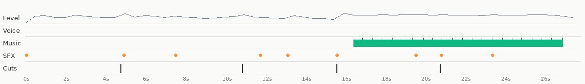

- Loudness -22.5 dBFS, peak -2.4 dBFS
- sound runs across cuts, laid in post as one bed (background changes 6.4dB at cuts vs 7.8dB within shots)
- tempo may also be 60.1/240.4 BPM; music on 38% of the duration (16.5–27.0s); section changes at 15.5s; 0% of cuts land on a beat (chance: about 10%)
- Music source: to confirm (stock library music 60%, AI-generated music 20%, well-known song 20%)
  - The music is a bed under the picture: in a regular video the bed usually comes from a stock library (prior)
  - Nothing about this track beyond the format prior and weak cues like the ending (no source heard, no platform music tag): source to confirm; an AI-generated bed cannot be told from a library bed here
  - How to confirm: Check the music tag on the original Douyin / Xiaohongshu / TikTok post: a song title → existing track; "original sound - @creator" → uploaded by the creator (for music videos, usually an AI song)
  - How to confirm: Run it through Shazam / ACRCloud or another song-ID service: a hit means an existing song

## Open questions

- Shot #1 (0.0–4.8s): embedded video clip: real material or generated, to confirm
- No AI listened to the soundtrack (the review covered the picture only): real voice versus TTS is inferred from the waveform; the effects were found on the separated effects track and their types are estimated from the sound. Play the stems and each effect under “Sound” to check
- music source to confirm: most likely stock library music (60%); how to check is under “Sound”

# Part two · Remake plan

## Remake it yourself: do it in this order

Copy the method and the rhythm, not the pictures: keep what each part does and fill it with your own content and material.

This is a motion-graphics explainer. Do the steps in this order; the detail for each is in the matching subsection below.

1. **Write the content**: write yours in the same 3 steps as the original (narrative line under “Content and structure”)
2. **Collect material**: the real material in the picture (photo, product photo, logo / brand mark) needs the original files, listed under “What to prepare”
3. **Motion graphics**: have the agent make an editable first version and change the text and pictures on top of it rather than starting from scratch; the first version is only a start, where it differs from the original is under “Code build”
4. **Subtitles and styled text**: import `packaging/subtitles.srt` and replace the words; timing and style under “Packaging layer”
5. **Music**: find a track at the same tempo and mood (source: to confirm, about 120 BPM)
6. **Sound effects**: 9; place similar ones from a library at the times under “Sound”
7. **Put it together and compare**: hand the shots you made to the agent; it places them on the original timeline, keeps the original where yours are missing, and renders a side-by-side comparison with the original

### What to prepare

- Real files shown in the picture (screenshots, photos, recordings; get the originals):
  - **product photo** (part of the frame): shots #1–#4, 20.8s in all
  - **photo** (part of the frame): shots #1–#4, 20.8s in all
  - **logo / brand mark** (part of the frame): shots #1–#4, 20.8s in all

### Code build

Rebuild it as one project in an HTML video framework (such as HyperFrames or Remotion): cuts, transitions and each shot's key frames from "Rhythm and key frames", layout, colours and elements from the scenes below. Text and UI are 100% controllable, changing copy is a data change, and an AI coding assistant can write the project.

`rea-video code-remake <breakdown folder>` only makes a quick draft: it renders `code/remake.mp4` from each scene's sampled points / cut-out, motion and background glow and scores it. Particles, point clouds and data visualisations on a dark ground come close; an illustrated character's acting and morph transitions do not.

- Part 1: shots #1–#5 (0.0–27.9s)

Remake assets (all in the report folder; hand them over together with the data below to whoever writes the code, or to an LLM):
- `shots/shot_XXX_first.jpg` / `_last.jpg`: first / last frame of each shot at full size, for layout, type size and margins
- `shots/shot_XXX_strip.jpg`: key frames about every 0.5 s, to follow the animation
- `shots/shot_XXX_elements.jpg` and `_el_NN.jpg` / `_st_NN.jpg` / `_ly_NN.jpg`: full-size crop of every element once settled, numbered as in the motion timeline; redraw shapes from them, cut out icons, logos and illustrations that cannot be redrawn
- `packaging/overlays.ass`, `packaging/timeline.json`: timing, position and colour of the text

How to build the pictures (by the measured picture type):
- UI / document: HTML / CSS cards and layout matched to the frame (radius, shadow, type sizes), elements enter with spring(); a real UI can be screen-recorded
- kinetic type: Word-by-word spring() entrances (offset + scale + opacity), highlight boxes on key words; match font, size and leading from the frame
- gradients / colour fields: CSS linear / radial gradients, or a few large circles with filter: blur() drifting slowly; glass cards with backdrop-filter

| Shot | Time | Build | Picture | Camera | Colours | On-screen text |
|---|---|---|---|---|---|---|
| #1 | 0.0–4.8s | UI / document | Split-screen product card for the 'Hazelnut cream & milk chocolate' flavour. Background: brown (#8B3A1A-ish) left / dark green right, split at roughly 1/3 width. Left panel: a column of whole hazelnuts with two green hazelnut leaves stacked in a tall column, with a slight drift/scale. Right panel: white pouch with green accents, 'Waffle Cones, filled with hazelnut cream & milk chocolate' which slides out from behind the seam, tilts about 10-15 degrees, holds, then slides back behind the seam before the transition. Fixed overlays: 'Just the Fun Part' white logo top-right, white 'Filled with / <flavour>' caption in a rounded hand-lettered font bottom-left, circular 'Real Belgian Chocolate' badge bottom-right. Transition in: the next colour panels wipe in as sliding rectangular blocks (panel wipe, about 0.3 s). | static frame, elements move inside it | ground #853a17 · #02572b #e8edf0 #4f200e #b7bdad · drawn #edefee #bdb79b #c07845 #103f1e | & Milk chocolate / Just the / fun / PART |
| #2 | 4.8–10.9s | kinetic type | Split-screen product card for the 'Pumpkin spice white chocolate' flavour. Background: tan/beige left / orange right, split at roughly 1/3 width. Left panel: cubes of pumpkin, cinnamon sticks and white chocolate chunks stacked in a tall column, with a slight drift/scale. Right panel: white pouch with orange Halloween graphics (pumpkins, bats), 'Pumpkin spice white chocolate' which slides out from behind the seam, tilts about 10-15 degrees, holds, then slides back behind the seam before the transition. Fixed overlays: 'Just the Fun Part' white logo top-right, white 'Filled with / <flavour>' caption in a rounded hand-lettered font bottom-left, circular 'Real Belgian Chocolate' badge bottom-right. Transition in: the next colour panels wipe in as sliding rectangular blocks (panel wipe, about 0.3 s). | static frame, elements move inside it | ground #c1a66f · #f37d05 #eeeae7 #d56718 #e4c9aa · drawn #f3eeea #e4c69a #dd5a09 #8f4115 | Just the / fun / Justthe / PART |
| #3 | 10.9–15.6s | gradients / colour fields | Split-screen product card for the 'Dark chocolate & marshmallow' flavour. Background: pale pink left / coral red right, split at roughly 1/3 width. Left panel: a column of white marshmallow cubes stacked in a tall column, with a slight drift/scale. Right panel: red pouch, 'S'mores Waffle Cones', dark chocolate & marshmallow which slides out from behind the seam, tilts about 10-15 degrees, holds, then slides back behind the seam before the transition. Fixed overlays: 'Just the Fun Part' white logo top-right, white 'Filled with / <flavour>' caption in a rounded hand-lettered font bottom-left, circular 'Real Belgian Chocolate' badge bottom-right. Transition in: the next colour panels wipe in as sliding rectangular blocks (panel wipe, about 0.3 s). | static frame, elements move inside it | ground #e74c57 · #9b0512 #e8cace #e7e3e6 #d3888a · drawn #dd4c54 #eacdd0 #f1ecef #73241e | Justthe / Just the / fun / PART |
| #4 | 15.6–20.8s | UI / document | Split-screen product card for the 'Peppermint dark chocolate' flavour. Background: dark red left / green right (Christmas colours), split at roughly 1/3 width. Left panel: a column of dark chocolate shards with fresh mint sprigs top and bottom stacked in a tall column, with a slight drift/scale. Right panel: white pouch with red/green Christmas graphics, 'Peppermint dark chocolate' which slides out from behind the seam, tilts about 10-15 degrees, holds, then slides back behind the seam before the transition. Fixed overlays: 'Just the Fun Part' white logo top-right, white 'Filled with / <flavour>' caption in a rounded hand-lettered font bottom-left, circular 'Real Belgian Chocolate' badge bottom-right. Transition in: the next colour panels wipe in as sliding rectangular blocks (panel wipe, about 0.3 s). | static frame, elements move inside it | ground #0c6443 · #9b0512 #471b17 #e4e2e5 #6f3932 · drawn #efedef #5c983b #790811 #beaea8 | Just the / fun / Justthe / PART |
| #5 | 20.8–27.9s | gradients / colour fields | End card / slogan. Starts with the peppermint scene being wiped off by a solid deep-red panel (about 20.84-20.9 s). Kinetic typography on deep red (#9A0010-ish): white rounded hand-lettered words fly in one by one, oversized, rotated, with motion blur, then shrink and settle into a centred lock-up: 'Only The Best Part / Of The / Sundae Cone!' (Only ~21.0 s, The ~22.6 s, Best Part ~23.5 s, Of The ~24.3 s, Sundae Cone! ~25.4-26.6 s). A white smile curve (the logo's smile) pops in under the text around 27.5 s, then the panels wipe straight back into the hazelnut scene (27.7-27.88 s) so the video loops seamlessly. | static frame, elements move inside it | ground #980510 · #9d0611 #fbf7fa #ac3542 #be6771 · drawn #fefbfd #f2d1d6 #e3a3ab #c7717c | Just the / PART |

**Picture scenes** (a new scene whenever what is drawn moves or changes shape as a whole inside a shot. `frames/` holds first / middle / last full-size frames per scene, `scene_XX_layer.png` the drawn layer of the middle frame (background and text removed, alpha by how strongly it stands out), `frames/points/scene_XX.json` samples of that layer, one `x y r g b a` per row with x, y in 0–1. Place particles, trace lines or redraw shapes from these instead of guessing from a description. `track` in `frames/scenes.json` follows the layer's centre and spread over time)

| Scene | Shot | Time | Ground | Background glow | Drawn colours | Pieces | Area (x0 y0 x1 y1) | Motion |
|---|---|---|---|---|---|---|---|---|
| scene_01 | #1 | 0.0–2.8s | #683c1b | #677f5e, centre (0.52, 0.60), radius 0.21 | #233817 #b97543 #e6cca9 | 317 | 0.09 0.06 0.58 0.94 | turns anticlockwise 1.6°/s, pans (-1.6%, +0.1%)/s, points wander |
| scene_02 | #1 | 2.8–4.8s | #683c1c | #aec0b2, centre (0.68, 0.47), radius 0.25 | #e9eceb #0e5826 #cd9264 | 82 | 0.38 0.04 0.88 0.96 | morphs in from the last scene, pans (-0.7%, +0.1%)/s, points wander |
| scene_03 | #2 | 4.8–8.3s | #d38f3c | #c9b788, centre (0.21, 0.70), radius 0.29 | #de580d #e1cd9b #913412 | 224 | 0.10 0.29 0.59 0.70 | turns anticlockwise 0.7°/s, pans (-0.5%, -0.1%)/s |
| scene_04 | #2 | 8.3–10.9s | #d48f3a | #e3c7b1, centre (0.63, 0.55), radius 0.22 | #eeece9 #a84a0e #d7bd85 | 103 | 0.40 0.28 0.90 0.74 | morphs in from the last scene, turns anticlockwise 2.2°/s, pans (-2.0%, -0.1%)/s, points wander |
| scene_05 | #3 | 10.9–15.6s | #e39eac | #da3852, centre (0.73, 0.51), radius 0.54 | #db3a54 #e8d7da | 21 | 0.41 0.02 0.59 0.98 | turns clockwise 1.0°/s, pans (-0.9%, +0.2%)/s |
| scene_06 | #4 | 15.6–17.9s | #436d40 | #8b0012, centre (0.24, 0.44), radius 0.49 | #8c0013 #370b0b #84c944 | 132 | 0.01 0.04 0.50 0.96 | turns clockwise 2.2°/s, pans (+1.4%, -0.2%)/s |
| scene_07 | #4 | 17.9–20.8s | #523229 | #c6b8b8, centre (0.68, 0.46), radius 0.26 | #187042 | 6 | 0.50 0.01 0.68 0.99 | morphs in from the last scene, zoom in 3%/s, turns anticlockwise 10.6°/s, pans (-5.4%, +0.5%)/s, points wander |
| scene_08 | #5 | 20.8–22.8s | #8c0012 | #cb8790, centre (0.65, 0.44), radius 0.22 | — | — | — | — |
| scene_09 | #5 | 22.8–24.6s | #8c0012 | #a02333, centre (0.59, 0.41), radius 0.22 | — | — | — | morphs in from the last scene, zoom out 67%/s, pans (+12.4%, -2.7%)/s |
| scene_10 | #5 | 24.6–27.9s | #8c0012 | #b95d69, centre (0.54, 0.48), radius 0.22 | — | — | — | morphs in from the last scene, zoom in 133%/s, turns anticlockwise 151.0°/s, pans (+6.1%, +4.7%)/s |

When built, score it with `rea-video compare original remake --scenes frames/scenes.json -o dir` (each side's drawn layer is taken against its own ground, so a new ground colour still compares) and fix the lowest-scoring scenes first, from `compare_worst.jpg`.

Per-shot motion timeline (measured: positions in % of frame width / height, colours sampled once the element settles; read together with the key-frame strip)

Motion #1 0.0–4.8s · 3 events

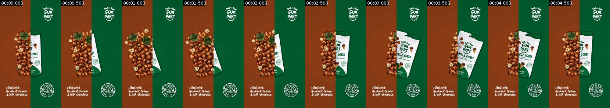

- Ground #853a17; other main colours #02572b #e8edf0 #4f200e #b7bdad; drawn layer #edefee #bdb79b #c07845 #103f1e
Element crops (numbers match the motion list below; L = the continuously moving layer mid-shot and at the end, S = elements that never move), full-size files in `shots/`:

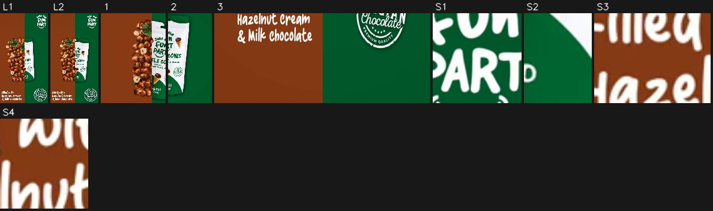

- S1. never moves: shape / text block · x 76%–84%, y 12%–16% · #02572c · text “fun / PART” · [crop](shots/shot_001_st_01.jpg)
- S2. never moves: shape / text block · x 58%–62%, y 64%–66% · #016532 · [crop](shots/shot_001_st_02.jpg)
- S3. never moves: shape / text block · x 13%–20%, y 82%–84% · #853a16 · text “Filled with” · [crop](shots/shot_001_st_03.jpg)
- S4. never moves: shape / text block · x 22%–27%, y 82%–84% · #853a16 · text “Filled with / Hazelnut cream” · [crop](shots/shot_001_st_04.jpg)
- [crop L1](shots/shot_001_ly_01.jpg) [crop L2](shots/shot_001_ly_02.jpg) · Continuous layer: 26% of the frame moves through the whole shot (x 9%–89%, y 6%–90%), e.g. drifting gradients, particle flow, breathing glow
1. 0.07–2.87s · middle left (x 2%–62%, y 26%–72%) · changes, unfolds leftward (draw-on / grow / wipe), ease-in-out · #895c2f · text “CONES / milk chocolate / IZED” · [crop](shots/shot_001_el_01.jpg)
2. 2.73–4.53s · middle right (x 56%–93%, y 30%–74%) · changes, moves upward, linear · #afbdac · text “CONES / milk chocolate / +the” · [crop](shots/shot_001_el_02.jpg)
3. 4.47–4.73s · bottom (x 0%–100%, y 85%–100%) · changes, moves rightward, ease-in · #dca26a · text “Hazelnut cream / & Milk chocolate / Chocolate” · [crop](shots/shot_001_el_03.jpg)

Motion #2 4.8–10.9s (wipe in) · 3 events

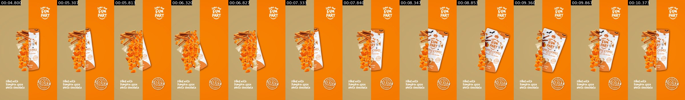

- Ground #c1a66f; other main colours #f37d05 #eeeae7 #d56718 #e4c9aa; drawn layer #f3eeea #e4c69a #dd5a09 #8f4115
Element crops (numbers match the motion list below; L = the continuously moving layer mid-shot and at the end, S = elements that never move), full-size files in `shots/`:

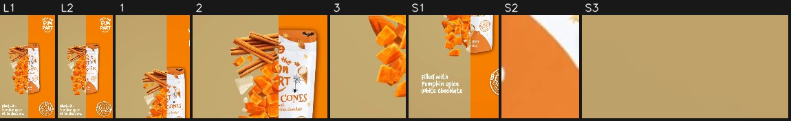

- S1. never moves: shape / text block · x 0%–71%, y 55%–100% · #f67d02 · text “te chocolate / IZED / Filled with” · [crop](shots/shot_002_st_01.jpg)
- S2. never moves: shape / text block · x 58%–62%, y 64%–66% · #ec8233 · [crop](shots/shot_002_st_02.jpg)
- S3. never moves: shape / text block · x 0%–7%, y 99%–100% · #bba169 · [crop](shots/shot_002_st_03.jpg)
- [crop L1](shots/shot_002_ly_01.jpg) [crop L2](shots/shot_002_ly_02.jpg) · Continuous layer: 24% of the frame moves through the whole shot (x 9%–89%, y 6%–90%), e.g. drifting gradients, particle flow, breathing glow
1. 4.87–5.00s · top (x 0%–71%, y 0%–55%) · changes, moves upward, instant · #c3a66e · text “CONES / te chocolate / colate” · [crop](shots/shot_002_el_01.jpg)
2. 5.47–7.87s · middle (x 4%–76%, y 26%–55%) · changes, moves rightward, ease-in-out · #e4a15b · text “CONES / te chocolate / colate” · [crop](shots/shot_002_el_02.jpg)
3. 5.53–7.80s · middle left (x 16%–38%, y 57%–74%) · changes, scales up, ease-in-out · #cfa24d · [crop](shots/shot_002_el_03.jpg)

Motion #3 10.9–15.6s (wipe in) · 2 events

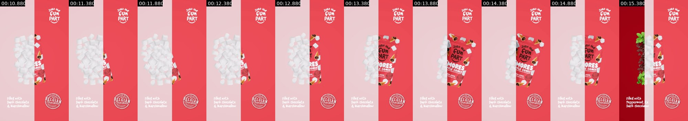

- Ground #e74c57; other main colours #9b0512 #e8cace #e7e3e6 #d3888a; drawn layer #dd4c54 #eacdd0 #f1ecef #73241e
Element crops (numbers match the motion list below; L = the continuously moving layer mid-shot and at the end, S = elements that never move), full-size files in `shots/`:

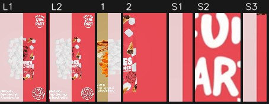

- S1. never moves: vertical line · x 49%–51%, y 0%–28% · #edcdd1 · [crop](shots/shot_003_st_01.jpg)
- S2. never moves: shape / text block · x 78%–82%, y 11%–16% · #fff9fc · text “PART / fun” · [crop](shots/shot_003_st_02.jpg)
- S3. never moves: vertical line · x 49%–51%, y 71%–100% · #edcdd1 · [crop](shots/shot_003_st_03.jpg)
- [crop L1](shots/shot_003_ly_01.jpg) [crop L2](shots/shot_003_ly_02.jpg) · Continuous layer: 20% of the frame moves through the whole shot (x 11%–89%, y 6%–90%), e.g. drifting gradients, particle flow, breathing glow
1. 10.95–11.01s · middle (x 24%–49%, y 0%–100%) · disappears, instant · #c3a66e · text “Dark chocolate / & Marshmallow” · [crop](shots/shot_003_el_01.jpg)
2. 13.21–15.35s · middle right (x 56%–93%, y 29%–73%) · changes, moves rightward, linear · #e07467 · text “NES / ARSMMALLOW / ELGI” · [crop](shots/shot_003_el_02.jpg)

Motion #4 15.6–20.8s (wipe in) · 2 events

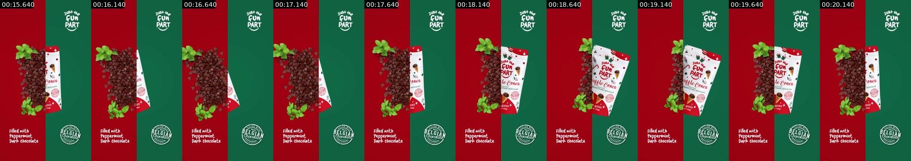

- Ground #0c6443; other main colours #9b0512 #471b17 #e4e2e5 #6f3932; drawn layer #efedef #5c983b #790811 #beaea8
Element crops (numbers match the motion list below; L = the continuously moving layer mid-shot and at the end, S = elements that never move), full-size files in `shots/`:

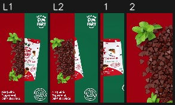

- [crop L1](shots/shot_004_ly_01.jpg) [crop L2](shots/shot_004_ly_02.jpg) · Continuous layer: 29% of the frame moves through the whole shot (x 9%–89%, y 6%–90%), e.g. drifting gradients, particle flow, breathing glow
1. 15.71–15.77s · middle (x 49%–67%, y 0%–100%) · changes, instant · #126544 · text “nes / OCOLATE / ZED” · [crop](shots/shot_004_el_01.jpg)
2. 19.37–20.77s · middle left (x 4%–40%, y 26%–65%) · changes, unfolds leftward (draw-on / grow / wipe), ease-in · #602b23 · [crop](shots/shot_004_el_02.jpg)

Motion #5 20.8–27.9s (wipe in) · 0 events

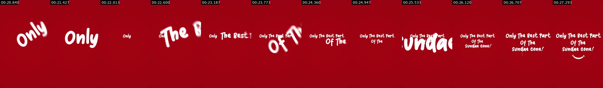

- Ground #980510; other main colours #9d0611 #fbf7fa #ac3542 #be6771; drawn layer #fefbfd #f2d1d6 #e3a3ab #c7717c
Element crops (numbers match the motion list below; L = the continuously moving layer mid-shot and at the end, S = elements that never move), full-size files in `shots/`:

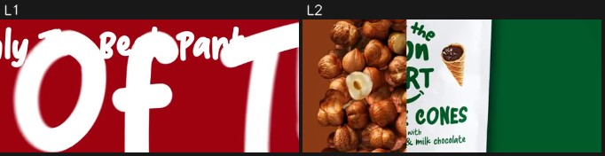

- [crop L1](shots/shot_005_ly_01.jpg) [crop L2](shots/shot_005_ly_02.jpg) · Continuous layer: 5% of the frame moves through the whole shot (x 27%–96%, y 39%–54%), e.g. drifting gradients, particle flow, breathing glow

### Edit

- Cut in the order and lengths of the shot list
- Approach: 4 flavour cards of about 5-6 s each, joined by panel-block wipes, then a 7 s kinetic-type end card that wipes back to the first card for a seamless loop.
- Rhythm: 8.6 cuts per minute, 5.58s average shot; no live-action shots; transitions wipe×4

**Transitions**

| Time | Into shot | Transition |
|---|---|---|
| 4.8–4.9s | #2 | wipe, 0.2s |
| 10.4–11.0s | #3 | wipe, 0.6s |
| 15.5–15.7s | #4 | wipe, 0.2s |
| 20.7–20.9s | #5 | wipe, 0.2s |

## Appendix

### Shot by shot

Each shot has two parts: what is visible on screen, and how the tools infer it was made (with the basis); remake prompts last. Folded by default.

#1 00:00.000–00:04.800 · code / template render; brings in real material (product photo, photo, logo / brand mark)

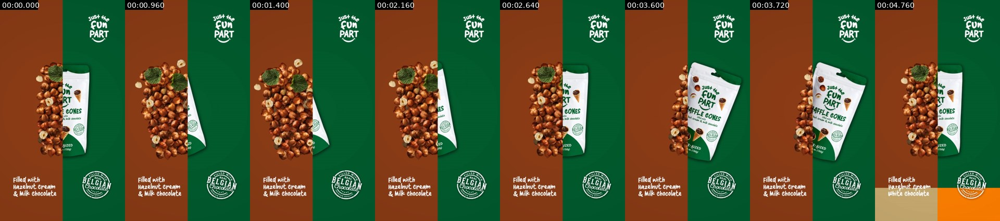

**Visible on screen** (check against the frames)
- Picture: Split-screen product card for the 'Hazelnut cream & milk chocolate' flavour. Background: brown (#8B3A1A-ish) left / dark green right, split at roughly 1/3 width. Left panel: a column of whole hazelnuts with two green hazelnut leaves stacked in a tall column, with a slight drift/scale. Right panel: white pouch with green accents, 'Waffle Cones, filled with hazelnut cream & milk chocolate' which slides out from behind the seam, tilts about 10-15 degrees, holds, then slides back behind the seam before the transition. Fixed overlays: 'Just the Fun Part' white logo top-right, white 'Filled with / <flavour>' caption in a rounded hand-lettered font bottom-left, circular 'Real Belgian Chocolate' badge bottom-right. Transition in: the next colour panels wipe in as sliding rectangular blocks (panel wipe, about 0.3 s).
- Text track (text in the picture/bottom): Filled with / BELGIAN / REAL / Hazelnut cream
- Text track (text in the picture/bottom): & Milk chocolate
- Text track (text in the picture/middle): CONES / milk chocolate / ES / ocolate
- Text track (text in the picture/middle): IZED / (021) / ¿ED / (602)
- [AI assistant review] Two flat solid-colour panels split the 9:16 frame vertically; no texture, grain or lighting falloff on the backgrounds. The ingredient pile and the pouch are clean cut-out photos/renders with hard alpha edges, moving rigidly (slide, tilt, scale) with no deformation, no texture boiling and no physics. The pouch is masked by the panel seam, so it slides out from 'behind' the left panel: a layer mask, typical of an After Effects / template composite. Fixed layout repeats in every flavour shot: 'Just the Fun Part' logo top-right, 'Real Belgian Chocolate' badge bottom-right, 'Filled with ...' caption bottom-left.
- [AI assistant review] Element motion is perfectly linear/eased keyframe motion (pouch rotates about a fixed pivot and slides out then back), the hallmark of keyframed 2D animation rather than a camera or a generative model.

**How it was made, as inferred by the tools** (inferred, not seen)
- Inference: code / template render 73%, 3D render 7%, AI-generated video 6% (fused_agent)
- Material: mixed (includes real material): product photo, photo, logo / brand mark; real or not, to confirm: embedded video clip
- Basis (tool measurements, not necessarily visible to the eye):
  - The picture is large saturated colour fields with almost no material texture (11% fine-texture pixels; footage, AI and 3D renders keep fabric / skin / noise texture): vector / gradient graphics drawn by code
  - Rendered texture: 70% flat colour blocks, 95% of pixels use only 91 colours, 11% axis-aligned edges
  - Dense fine high-frequency detail on a flat background (small text / UI), looks like a screenshot or document
  - Per-frame sharpness oscillates periodically (period 6 frames, correlation 0.17) with no duplicate frames: frame interpolation / rate conversion, or just the rhythm of a re-encode (transcodes whose platform tags were stripped show it too); not enough on its own to call AI

- Remake: Code render: rebuild in an HTML video framework (such as HyperFrames or Remotion) from the rhythm, key frames and layout, 100% controllable, no generative model needed; real material the user must supply: product photo (part of the frame), photo (part of the frame), logo / brand mark (part of the frame)

#2 00:04.800–00:10.880 · code / template render; brings in real material (product photo, photo, logo / brand mark)

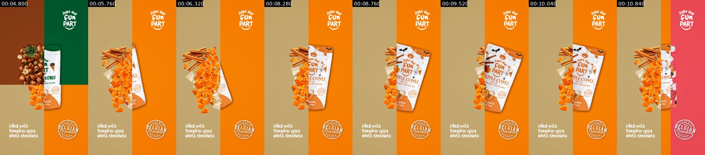

**Visible on screen** (check against the frames)
- Picture: Split-screen product card for the 'Pumpkin spice white chocolate' flavour. Background: tan/beige left / orange right, split at roughly 1/3 width. Left panel: cubes of pumpkin, cinnamon sticks and white chocolate chunks stacked in a tall column, with a slight drift/scale. Right panel: white pouch with orange Halloween graphics (pumpkins, bats), 'Pumpkin spice white chocolate' which slides out from behind the seam, tilts about 10-15 degrees, holds, then slides back behind the seam before the transition. Fixed overlays: 'Just the Fun Part' white logo top-right, white 'Filled with / <flavour>' caption in a rounded hand-lettered font bottom-left, circular 'Real Belgian Chocolate' badge bottom-right. Transition in: the next colour panels wipe in as sliding rectangular blocks (panel wipe, about 0.3 s).
- Text track (text in the picture/bottom): Filled with / BELGIAN / REAL / pumpkin spice
- Text track (text in the picture/bottom): White chocolate / white chocolate
- Text track (text in the picture/middle): CONES / te chocolate / colate / ES
- Text track (text in the picture/middle): IZED / (20D) / ED / ZED
- [AI assistant review] Two flat solid-colour panels split the 9:16 frame vertically; no texture, grain or lighting falloff on the backgrounds. The ingredient pile and the pouch are clean cut-out photos/renders with hard alpha edges, moving rigidly (slide, tilt, scale) with no deformation, no texture boiling and no physics. The pouch is masked by the panel seam, so it slides out from 'behind' the left panel: a layer mask, typical of an After Effects / template composite. Fixed layout repeats in every flavour shot: 'Just the Fun Part' logo top-right, 'Real Belgian Chocolate' badge bottom-right, 'Filled with ...' caption bottom-left.
- [AI assistant review] Element motion is perfectly linear/eased keyframe motion (pouch rotates about a fixed pivot and slides out then back), the hallmark of keyframed 2D animation rather than a camera or a generative model.

**How it was made, as inferred by the tools** (inferred, not seen)
- Inference: code / template render 69%, 3D render 11%, AI-generated video 8% (fused_agent)
- Material: mixed (includes real material): product photo, photo, logo / brand mark
- Basis (tool measurements, not necessarily visible to the eye):
  - Per-frame sharpness oscillates periodically (period 2 frames, correlation 0.36) with no duplicate frames: frame interpolation / rate conversion, or just the rhythm of a re-encode (transcodes whose platform tags were stripped show it too); not enough on its own to call AI

- Remake: Code render: rebuild in an HTML video framework (such as HyperFrames or Remotion) from the rhythm, key frames and layout, 100% controllable, no generative model needed; real material the user must supply: product photo (part of the frame), photo (part of the frame), logo / brand mark (part of the frame)

#3 00:10.880–00:15.640 · code / template render; brings in real material (product photo, photo, logo / brand mark)

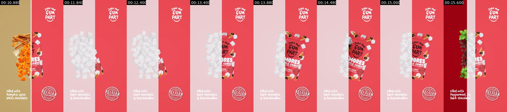

**Visible on screen** (check against the frames)
- Picture: Split-screen product card for the 'Dark chocolate & marshmallow' flavour. Background: pale pink left / coral red right, split at roughly 1/3 width. Left panel: a column of white marshmallow cubes stacked in a tall column, with a slight drift/scale. Right panel: red pouch, 'S'mores Waffle Cones', dark chocolate & marshmallow which slides out from behind the seam, tilts about 10-15 degrees, holds, then slides back behind the seam before the transition. Fixed overlays: 'Just the Fun Part' white logo top-right, white 'Filled with / <flavour>' caption in a rounded hand-lettered font bottom-left, circular 'Real Belgian Chocolate' badge bottom-right. Transition in: the next colour panels wipe in as sliding rectangular blocks (panel wipe, about 0.3 s).
- Text track (text in the picture/bottom): Filled with / BELGIAN / REAL / Dark chocolate
- Text track (text in the picture/bottom): & Marshmallow / Dark chocolate / QUALITY
- Text track (text in the picture/middle): NES / ARSMMALLOW / JES / SHMALLOW
- Text track (text in the picture/middle): 120C) / IZED / p2(120G) / E-SIZED
- [AI assistant review] Two flat solid-colour panels split the 9:16 frame vertically; no texture, grain or lighting falloff on the backgrounds. The ingredient pile and the pouch are clean cut-out photos/renders with hard alpha edges, moving rigidly (slide, tilt, scale) with no deformation, no texture boiling and no physics. The pouch is masked by the panel seam, so it slides out from 'behind' the left panel: a layer mask, typical of an After Effects / template composite. Fixed layout repeats in every flavour shot: 'Just the Fun Part' logo top-right, 'Real Belgian Chocolate' badge bottom-right, 'Filled with ...' caption bottom-left.
- [AI assistant review] Element motion is perfectly linear/eased keyframe motion (pouch rotates about a fixed pivot and slides out then back), the hallmark of keyframed 2D animation rather than a camera or a generative model.

**How it was made, as inferred by the tools** (inferred, not seen)
- Inference: code / template render 73%, 3D render 11%, AI-generated video 5% (fused_agent)
- Material: mixed (includes real material): product photo, photo, logo / brand mark
- Basis (tool measurements, not necessarily visible to the eye):
  - The picture is large saturated colour fields with almost no material texture (11% fine-texture pixels; footage, AI and 3D renders keep fabric / skin / noise texture): vector / gradient graphics drawn by code
  - Rendered texture: 71% flat colour blocks, 95% of pixels use only 21 colours, 20% axis-aligned edges

- Remake: Code render: rebuild in an HTML video framework (such as HyperFrames or Remotion) from the rhythm, key frames and layout, 100% controllable, no generative model needed; real material the user must supply: product photo (part of the frame), photo (part of the frame), logo / brand mark (part of the frame)

#4 00:15.640–00:20.840 · code / template render; brings in real material (product photo, photo, logo / brand mark)

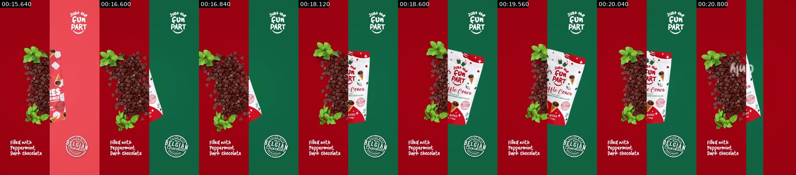

**Visible on screen** (check against the frames)
- Picture: Split-screen product card for the 'Peppermint dark chocolate' flavour. Background: dark red left / green right (Christmas colours), split at roughly 1/3 width. Left panel: a column of dark chocolate shards with fresh mint sprigs top and bottom stacked in a tall column, with a slight drift/scale. Right panel: white pouch with red/green Christmas graphics, 'Peppermint dark chocolate' which slides out from behind the seam, tilts about 10-15 degrees, holds, then slides back behind the seam before the transition. Fixed overlays: 'Just the Fun Part' white logo top-right, white 'Filled with / <flavour>' caption in a rounded hand-lettered font bottom-left, circular 'Real Belgian Chocolate' badge bottom-right. Transition in: the next colour panels wipe in as sliding rectangular blocks (panel wipe, about 0.3 s).
- Text track (text in the picture/bottom): LED / Filled with / BELGIAN / REAL
- Text track (text in the picture/bottom): Dark chocolate / Chocolate
- Text track (text in the picture/middle): nes / OCOLATE / ATE / ones
- Text track (text in the picture/middle): ZED / (602 / (202) / Chocol
- [AI assistant review] Two flat solid-colour panels split the 9:16 frame vertically; no texture, grain or lighting falloff on the backgrounds. The ingredient pile and the pouch are clean cut-out photos/renders with hard alpha edges, moving rigidly (slide, tilt, scale) with no deformation, no texture boiling and no physics. The pouch is masked by the panel seam, so it slides out from 'behind' the left panel: a layer mask, typical of an After Effects / template composite. Fixed layout repeats in every flavour shot: 'Just the Fun Part' logo top-right, 'Real Belgian Chocolate' badge bottom-right, 'Filled with ...' caption bottom-left.
- [AI assistant review] Element motion is perfectly linear/eased keyframe motion (pouch rotates about a fixed pivot and slides out then back), the hallmark of keyframed 2D animation rather than a camera or a generative model.

**How it was made, as inferred by the tools** (inferred, not seen)
- Inference: code / template render 70%, 3D render 8%, AI-generated video 7% (fused_agent)
- Material: mixed (includes real material): product photo, photo, logo / brand mark
- Basis (tool measurements, not necessarily visible to the eye):
  - The picture is large saturated colour fields with almost no material texture (12% fine-texture pixels; footage, AI and 3D renders keep fabric / skin / noise texture): vector / gradient graphics drawn by code
  - Dense fine high-frequency detail on a flat background (small text / UI), looks like a screenshot or document

- Remake: Code render: rebuild in an HTML video framework (such as HyperFrames or Remotion) from the rhythm, key frames and layout, 100% controllable, no generative model needed; real material the user must supply: product photo (part of the frame), photo (part of the frame), logo / brand mark (part of the frame)

#5 00:20.840–00:27.880 · code / template render

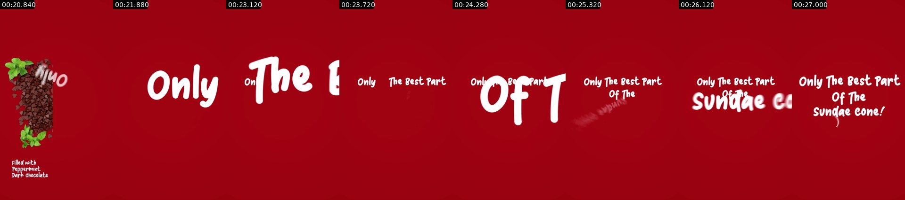

**Visible on screen** (check against the frames)
- Picture: End card / slogan. Starts with the peppermint scene being wiped off by a solid deep-red panel (about 20.84-20.9 s). Kinetic typography on deep red (#9A0010-ish): white rounded hand-lettered words fly in one by one, oversized, rotated, with motion blur, then shrink and settle into a centred lock-up: 'Only The Best Part / Of The / Sundae Cone!' (Only ~21.0 s, The ~22.6 s, Best Part ~23.5 s, Of The ~24.3 s, Sundae Cone! ~25.4-26.6 s). A white smile curve (the logo's smile) pops in under the text around 27.5 s, then the panels wipe straight back into the hazelnut scene (27.7-27.88 s) so the video loops seamlessly.
- Text track (text in the picture/middle): Only / B / The Best Part / Only The Best Part
- Text track (text in the picture/middle): unda / sundtae cone / Sundae cone! / Of The
- Text track (text in the picture/top): Just the
- Text track (text in the picture/top): PART
- [AI assistant review] Flat single-colour red background (2 colours make up 95% of pixels), 95% of the background never changes; only white text moves.
- [AI assistant review] Words fly in one at a time, huge and rotated with motion blur, then shrink into a centred 3-line lock-up: classic kinetic-typography animation.

**How it was made, as inferred by the tools** (inferred, not seen)
- Inference: code / template render 88%, 3D render 4%, 2D animation 2% (fused_agent)
- Material: rendered by the creator
- Basis (tool measurements, not necessarily visible to the eye):
  - The picture is large saturated colour fields with almost no material texture (2% fine-texture pixels; footage, AI and 3D renders keep fabric / skin / noise texture): vector / gradient graphics drawn by code
  - Rendered texture: 93% flat colour blocks, 95% of pixels use only 2 colours, 19% axis-aligned edges
  - 95% of background pixels never change frame to frame while local elements move: 2D compositing / code-driven motion graphics
  - Per-frame sharpness oscillates periodically (period 2 frames, correlation 0.05) with no duplicate frames: frame interpolation / rate conversion, or just the rhythm of a re-encode (transcodes whose platform tags were stripped show it too); not enough on its own to call AI

- Remake: Code render: rebuild in an HTML video framework (such as HyperFrames or Remotion) from the rhythm, key frames and layout, 100% controllable, no generative model needed

### Metadata clues

- Encoder: `Lavf61.1.100`

### Notes

- Deterministic forensics is reliable on motion, whole-frame pan/zoom, rendered texture and 24→30 fps conversion; telling live action from AI from 3D needs image reading (a VLM or an AI assistant's review), and a look at the frames yourself.
- Platform transcoding usually strips metadata; missing metadata proves nothing.
- The full data is in `breakdown.json`; the package for models starts at `VIDEO.md`.

---

Made with [REA-VIDEO](https://github.com/JuneYaooo/rea-video) · https://github.com/JuneYaooo/rea-video
