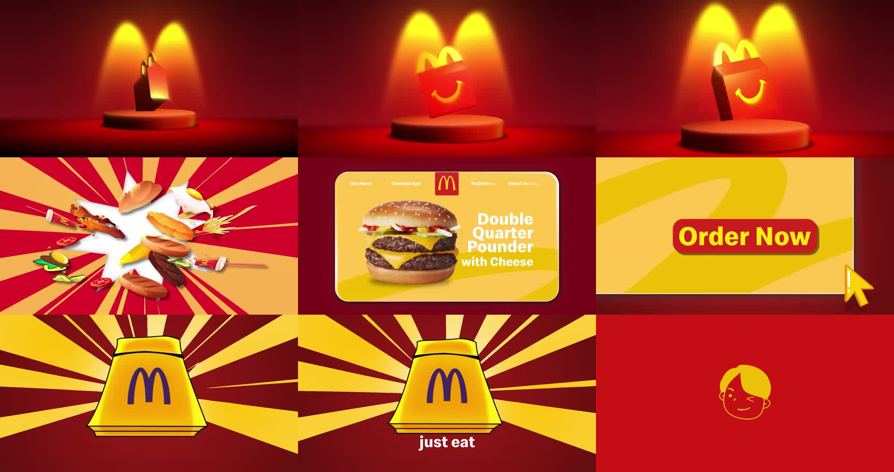

# Shot-by-shot breakdown: @bymike0404 — McDonald's spec ad

**Source:** https://www.tiktok.com/@bymike0404/video/7604506104940285214 (posted 2026-02-08; caption: *"Day 2 of making commercials for brands I love. This is a @mcdonalds spec ad … not an official campaign"*, tagged `#aftereffects #motiongraphics`)
**File analysed:** 21.43 s · 2048×1080 (horizontal) · 30 fps · HEVC, TikTok re-encode
**Tool:** [rea-video](https://github.com/JuneYaooo/rea-video) (`survey` → `decompose --lang en` → agent visual review of all 16 shots → `apply-review`). No external vision model was used. I reviewed every shot by eye.

---

## Verdict

**A motion-graphics spec ad made in After Effects.** About 92% of the runtime is 2D motion graphics (kinetic type, UI cards, comic sunbursts) and about 8% is a light 3D opener. Real McDonald's product photos and logos are cut out and placed into it. Nothing is live-action and nothing is AI-generated.

The structure is simple: one **~9.3 s ad that plays twice** (the second pass reorders the burger carousel), then a **2 s creator logo sting**. The soundtrack is a rapped hip-hop hook. The ASR heard *"I gotta testify, come up in the spot lookin' extra fly / for the day I die, I'mma touch the sky"*, which is the hook of **Kanye West – "Touch the Sky"** (to confirm). Cuts land on the vocal phrases.

---

## Structure at a glance

| Block | Time | Shots | Narrative job |
|---|---|---|---|
| Ad, pass 1 | 0:00.0 – 0:10.4 | #1–#8 | Hook → brand callout → menu → "Order Now" → tagline → end card |
| Loop bridge | 0:10.4 – 0:11.1 | #9–#10 | 3-frame flash of the opener + ingredient burst restarts the loop |
| Ad, pass 2 | 0:11.1 – 0:19.4 | #11–#15 | Same beats; the carousel starts on Big Mac this time |
| Creator sting | 0:19.4 – 0:21.4 | #16 | Creator's winking-face logo |

Editing pace: 16 shots in 21.4 s, so about 42 cuts per minute and 1.3 s per shot on average.

---

## Shot list

| # | Time | Len | What's on screen | Motion / transition out | Made with | Real material |
|---|---|---|---|---|---|---|
| **1** | 0:00.00–0:01.70 | 1.70s | Dark-crimson stage. **Two yellow spotlight cones form the Golden Arches.** A red Happy Meal box (arch handle, smile) on a round pedestal rotates from side-on to front, tips back, and a burger cut-out pops up and rises. | Slow push-in. Hard pop into the burst on the burger's rise. | Light 3D (AE 3D layers / C4D-style extrusion) + glow; the burger is a photo cut-out | Burger photo |
| **2** | 0:01.70–0:02.23 | 0.53s | White comic "POW" star bursts on a red/yellow sunburst. Ingredients (bun, patties, bacon, egg, tomato, lettuce, fries, branded cups) explode outward and spin. | **Whip-pan right** with motion streaks | 2D MG, illustrated cut-outs | — |
| **3** | 0:02.23–0:03.60 | 1.37s | Deep red with a giant darker **"?"**. White *"Somebody say"* animates in word by word, then big yellow ***"McDonald's"***. Golden fries and a fry stick fly diagonally. | **Zoom-through:** a dark rounded rectangle opens in the centre and grows into the web card | Kinetic typography | — |
| **4** | 0:03.60–0:05.90 | 2.30s | Yellow **website-style card** (nav: *Our Menu · Dowload App · McDelivery · About Our Food*, red M tile) on a dark red vignette. The hero product swaps on the beat: **Daily Double → Double Quarter Pounder w/ Cheese → McDouble → Pounder with Cheese → Big Mac**, each with big white stacked type. | Card scales up and **defocus-blurs out**. Hard cut. | UI-card MG (a mock-up, not a screen recording; note the "Dowload" typo) | 5 product photos, logo |
| **5** | 0:05.90–0:06.57 | 0.67s | Empty dark red, big yellow **arrow cursor** in the centre. The next card slides in diagonally from the top-left. | Punch-in cut onto the card | 2D MG | — |
| **6** | 0:06.57–0:07.93 | 1.37s | Close-up of the card: red pill button **"Order Now"**. The cursor glides in from bottom-right and **clicks**. The button squashes, the card shrinks, and the button flies to centre. | **Cut on the click** (whoosh ~7.6s) | 2D MG / UI animation | — |
| **7** | 0:07.93–0:09.17 | 1.23s | Big yellow **cartoon fries box/bag** with thick black outline and purple M, bouncing on spinning red/yellow sunburst rays. Text pops in word by word: ***"just" … "eat"***. | Hard cut | 2D cel-style MG | — |
| **8** | 0:09.17–0:10.43 | 1.27s | Flat McDonald's-red **end card**: small yellow arches + *"i'm lovin' it"*, with a subtle scale. | Logo streaks/blurs down. Hard cut. | Flat MG | Logo |
| **9** | 0:10.43–0:10.53 | 0.10s | **3-frame flash** of shot 1's spotlight stage with the burger rising | Straight into the burst | Repeat of #1 | — |
| **10** | 0:10.53–0:11.07 | 0.53s | Same ingredient burst as #2 | Whip-pan | Repeat of #2 | — |
| **11** | 0:11.07–0:14.73 | 3.67s | Shots #3 and #4 again in one take: *"Somebody say McDonald's"* (to ~12.3s), zoom into the web card, then the carousel **Big Mac → Daily Double → DQPC → McDouble → Pounder w/ Cheese → Big Mac**, then a defocus blur. (Could be split at 12.3s.) | Hard cut | Same MG as #3 + #4 | Product photos, logo |
| **12** | 0:14.73–0:15.40 | 0.67s | Same as #5 (cursor, card slides in) | Punch-in | Repeat | — |
| **13** | 0:15.40–0:16.77 | 1.37s | Same as #6 ("Order Now" click) | Cut on click (whoosh ~16.5s) | Repeat | — |
| **14** | 0:16.77–0:18.00 | 1.23s | Same as #7 (fries box, "just eat") | Hard cut | Repeat | — |
| **15** | 0:18.00–0:19.43 | 1.43s | Same as #8 (end card, held 0.16s longer) | Hard cut | Repeat | Logo |
| **16** | 0:19.43–0:21.43 | 2.00s | **Creator sting:** yellow line-art face of a boy with a side fringe, **winking**, centred on the same red. Held to the end. | End (the music is cut off hard) | Flat MG logo | Creator's own logo |

Full-resolution contact sheets (every 0.3 s): [0–10 s](contact_0-10s.jpg) · [10–21 s](contact_10-21s.jpg)

---

## Why it works

- **0–1.7s, a logo hidden in the light.** The two spotlight beams *are* the Golden Arches. The brand registers before any text appears.
- **1.7s, a fast pattern break.** The calm reveal explodes into a comic burst within two seconds, so there is no slow intro.
- **3.6–5.9s, beat-swapped carousel.** Five menu items appear in about 2.3 s inside a familiar "website" frame, so it reads as information rather than clutter.
- **6.6–7.9s, the CTA is acted out.** The cursor clicks "Order Now" and that click *is* the cut to the "just eat" tagline.
- **Loop structure.** Playing the ad twice makes it feel like a seamless TikTok loop and doubles watch time. The 2 s creator logo turns it into a portfolio piece.

---

## Packaging (text layer)

All on-screen text is **part of the motion-graphics picture**, not an editor overlay. There are no subtitles. The text elements are:

- *"Somebody say" / "McDonald's"*: white + bold yellow, word-by-word slide-in (2.3–3.5s, 11.1–12.3s)
- Product names in the card (white, heavy rounded sans, 2–4 stacked lines)
- Nav labels *Our Menu / Dowload App / McDelivery / About Our Food* (small white)
- *"Order Now"*: yellow text on a red pill with a dark drop edge
- *"just" … "eat"*: white bold, popped on separate beats (8.3s, 16.9s)
- *"i'm lovin' it"* wordmark under the arches (9.2s, 18.0s)

The typeface looks like a heavy rounded geometric sans (similar to McDonald's "Speedee"). That is from visual inspection only.

---

## Sound

| Element | Finding | Confidence |
|---|---|---|
| **Music / vocal** | A hip-hop track with a **rapped vocal across the whole runtime**. The ASR on the separated vocal stem heard *"I gotta testify / come up in the spot lookin' extra fly / for the day I die / I'mma touch the sky"*, twice. This matches the hook of **Kanye West – "Touch the Sky" (2005)**. Measured tempo 141.6 BPM (≈ 70.8 half-time), estimated key F major. The track is **cut off hard** at 21.4s. | Lyrics: high. Song ID: **to confirm** (Shazam it). TikTok lists it only as "original sound – bymike". |
| **Voice-over** | **None.** The vocal is the song's rap, not a narrator. | High. rea-video's auto-label of "TTS voice-over" is wrong here: its vocal detector picked up the rap. |
| **SFX** | Candidates: pop at ~4.7s (product swap), whoosh at ~7.6s and ~16.5s (Order Now button flying out) | Low: signal-level detection only, light effects may be missed |
| **Cut-to-music** | Section changes land on the vocal phrases: the "Order Now" click and "just eat" fall under "for the day I die… touch the sky". Measured on-beat ratio is about chance level (33%), so the edit follows the **phrases** rather than every beat. | Medium |

Rights note: if this is the commercial Kanye West track, a remake needs a licensed or royalty-free replacement at ~71/142 BPM.

---

## Material you would need to supply to remake it

1. **Product cut-outs** (transparent PNGs): Daily Double, Double Quarter Pounder w/ Cheese, McDouble, Quarter Pounder w/ Cheese, Big Mac, plus a burger for the opener. These are real product photos, not generated.
2. **Brand marks:** Golden Arches, "i'm lovin' it" wordmark, Happy Meal box design. All are trademarks; fine for a clearly labelled spec piece, not for a real ad without permission.
3. **Illustrated ingredient set** for the burst (bun, patties, bacon, egg, tomato, lettuce, fries, cups). Stock or drawn.
4. **Your own end-sting logo** (replaces shot 16).
5. **Music**: licensed track or a similar royalty-free hip-hop beat.

---

## How to remake it

This is a **code / motion-graphics build**, not a video-model job. No AI generation is needed.

1. **After Effects** (what the creator used) or a code framework (Remotion / HyperFrames) at 2048×1080 (or 1920×1080), 30 fps.
2. Build **one 9.3 s comp**: 3D stage opener → burst + whip-pan → kinetic-type callout → zoom-through into the UI card → beat-synced product swaps → cursor + "Order Now" click → sunburst tagline → end card.
3. **Duplicate the comp** for pass 2, reorder the carousel (start on Big Mac), and add the 3-frame opener flash as the loop bridge.
4. Add the 2 s logo sting and lay the music under it, cutting on vocal phrases.
5. Palette: McDonald's red (~#DA291C / dark-red vignette ~#7A0A0A) and yellow (~#FFC72C). These values are approximate, read from frames.

Per-shot motion timelines, element crops and keyframe strips are in [`rea-video/report.html`](rea-video/report.html) (open it with the `rea-video/` folder; it needs `shots/` next to it).

---

## Open questions

- **Song ID:** strongly suggested by the lyrics, but not verified with a song-ID service.
- **Opener (#1, #9): 3D or 2.5D?** The box turns in true perspective with smooth gradient shading, so I lean 3D (≈60%). It could also be AE's 3D layers with a flat-shaded extrusion. It makes no difference to the remake approach.
- **SFX list** is low-confidence: light pops and whooshes may be missing or mis-timed.
- The file is a TikTok re-encode, so noise and metadata evidence was unusable. The verdict rests on visual review, which is unambiguous for motion graphics.
