# How this video was made: tiktok_7604506104940285214.mp4

**In one line**: An unofficial McDonald's spec ad built entirely in motion graphics: product reveal, kinetic type, a fake website menu carousel and an 'Order Now' click, cut tightly to a hip-hop hook and looped twice.
**How it was made**: Mixed production: code / template render 92% + 3D render 8%

- 0:21 · horizontal 2048:1080 · 16 shots, 1.3s each on average
- Confidence 86%, based on: tool measurements + AI assistant reviewed 16 shots
- ⚠️ 3 points are uncertain, see “Open questions”

<!--mix-->

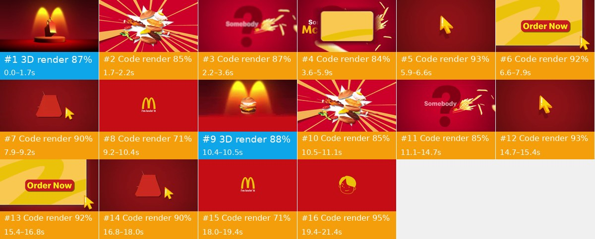

# Part one · Breakdown: how this video is built

## What makes it work

- **The hook**: 0-1.7s: a Happy Meal box turns on a pedestal under spotlights shaped like the Golden Arches, then a burger pops out and explodes into flying ingredients at 1.7s - instant brand recognition plus a visu
- 0-1.7s: the spotlight beams themselves form the Golden Arches - a brand logo hidden in the lighting, rewarding a second look
- 3.6-5.9s: products swap on every beat inside a website-style card, so five menu items are shown in ~2s without feeling rushed
- 5.9-7.9s: a cursor clicks 'Order Now' and the click itself becomes the cut into the 'just eat' tagline - the CTA is acted out, not just shown
- 0-19.4s: the whole ~9.3s ad plays twice, so on TikTok it reads like a seamless loop and doubles watch time; the 2s creator logo at the end brands the portfolio piece

## At a glance: picture, packaging, sound

Any short video splits into three layers: the picture, what is laid on top of it (subtitles, styled text, stickers), and the sound. Remake it one layer at a time.

| Layer | In this video | How to make it | Detail |
|---|---|---|---|
| **Picture** (base) | code / template render 14 shots, 3D render 2 shots | AI in 1 generation, repeated clips cut from the result; screen recording / motion graphics in code | “Remake it yourself” |
| **Packaging** (on top) | text | add in the editor: subtitles, styled text and stickers by the timeline | “Packaging layer” |
| **Sound** | voice（TTS voice-over）, music (142 BPM, to confirm), 3 sound effects | voice: TTS voice-over; music: find a track with the same tempo and mood; effects: add from a library at the listed times | “Sound” |

## Content and structure

- The narrative line below comes from reading each shot; the lines were not transcribed separately, subtitle text is under “Packaging layer”

**Narrative line**

Keep this line in a remake: same order, same job at each step, with the point refilled from your own cases, numbers and material, so it is more than a change of subject.

| Time | Shots | Job | What it says |
|---|---|---|---|
| 0.0–2.2s | #1, #2 | grab attention | Open on a glowing product reveal on a stage: the box turns, opens and a hero item rises → Burst the hero item into its ingredients for an energetic transition |
| 2.2–3.6s | #3 | set the scene | Kinetic-type callout that names the brand |
| 3.6–6.6s | #4, #5 | add information | Show the menu as a slick website mock-up, cycling through hero products → A cursor appears to set up the 'online ordering' gesture |
| 6.6–7.9s | #6 | call to action | Simulate clicking an 'Order Now' button |
| 7.9–10.4s | #7, #8 | deliver the conclusion | Punchline tagline over a bold branded hero object → Brand end card |
| 10.4–11.1s | #9, #10 | set the mood | Flash back to the opening reveal to restart the loop → Repeat the ingredient burst transition |
| 11.1–15.4s | #11, #12 | add information | Second pass of the brand callout and menu carousel → Repeat cursor set-up |
| 15.4–16.8s | #13 | call to action | Repeat the Order Now click |
| 16.8–19.4s | #14, #15 | deliver the conclusion | Repeat tagline → Repeat brand end card |
| 19.4–21.4s | #16 | call to action | Creator's signature logo sting to brand the portfolio piece |

## Shot list

Picture, Camera and Overlays are what is visible on screen; Made with and Material are the tools' inference, with the basis in the shot-by-shot appendix.

| # | Frames | Time | Length | What it says | Picture | Camera | Overlays | Made with (inferred) | Material (inferred) |
|---|---|---|---|---|---|---|---|---|---|
| 1 |  | 0:00.0 | 1.7s | grab attention: Open on a glowing product reveal… | Dark red stage, two warm yellow spotligh… | smooth move | text | 3D render 87% | rendered by the creator |
| 2 |  | 0:01.7 | 0.5s | grab attention: Burst the hero item into its ing… | Hard pop from the rising burger into a w… | smooth move | — | code / template render 85% | rendered by the creator |
| 3 | 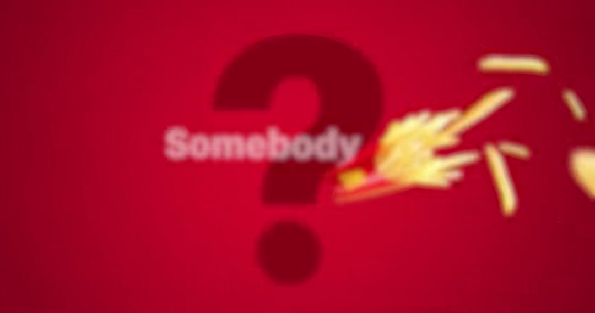 | 0:02.2 | 1.4s | set the scene: Kinetic-type callout that names t… | Deep red background with a large darker … | smooth move | — | code / template render 87% | rendered by the creator |
| 4 |  | 0:03.6 | 2.3s | add information: Show the menu as a slick websit… | Yellow rounded web-page card with soft d… | smooth move | — | code / template render 84% | product photo, logo / brand mark; real or not, to confirm: photo / image |
| 5 |  | 0:05.9 | 0.7s | add information: A cursor appears to set up the … | Empty dark red vignette with a large yel… | smooth move | — | code / template render 93% | rendered by the creator |
| 6 |  | 0:06.6 | 1.4s | call to action: Simulate clicking an 'Order Now'… | Close-up of the yellow card with a large… | smooth move | — | code / template render 92% | rendered by the creator |
| 7 | 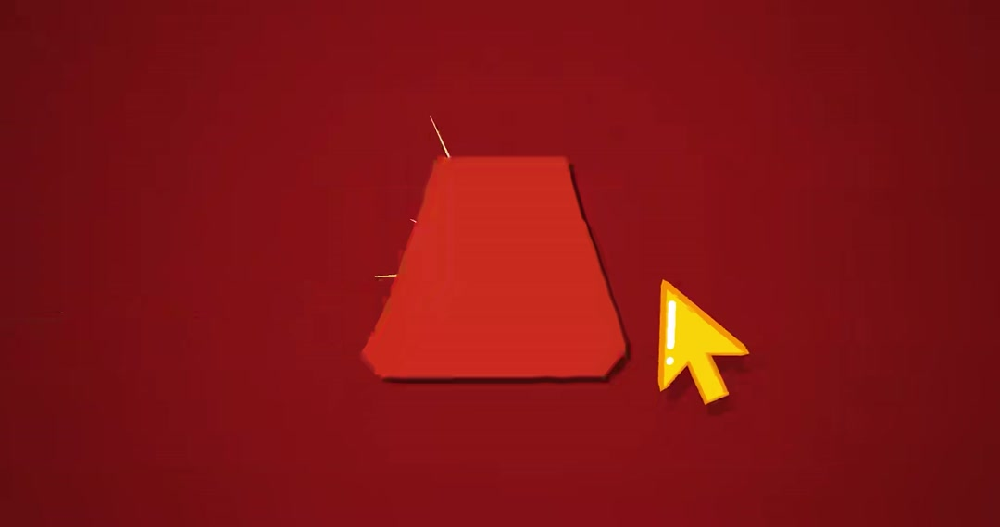 | 0:07.9 | 1.2s | deliver the conclusion: Punchline tagline over a… | Hard cut on the click to a big yellow ca… | smooth move | — | code / template render 90% | rendered by the creator |
| 8 | 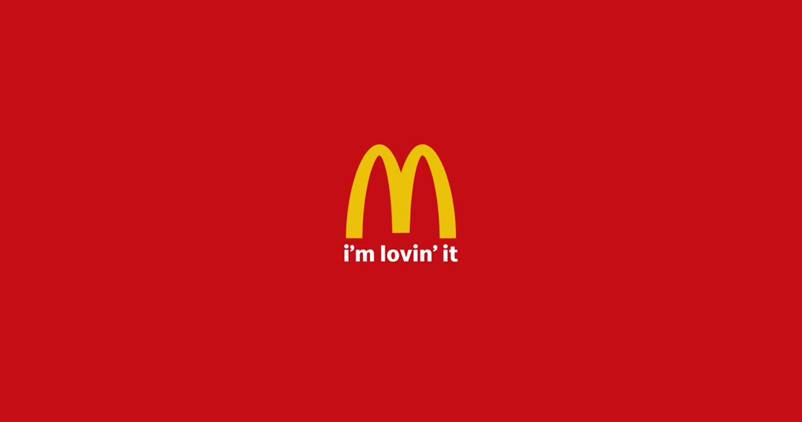 | 0:09.2 | 1.3s | deliver the conclusion: Brand end card | Flat McDonald's red end card, small yell… | whole-frame zoom / pan | — | code / template render 71% | logo / brand mark |
| 9 | 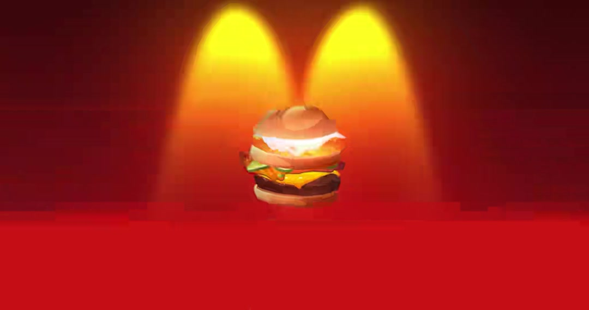 | 0:10.4 | 0.1s | set the mood: Flash back to the opening reveal t… | 3-frame flash of the opening spotlight s… | static (subject moves) | — | 3D render 88% | rendered by the creator |
| 10 | 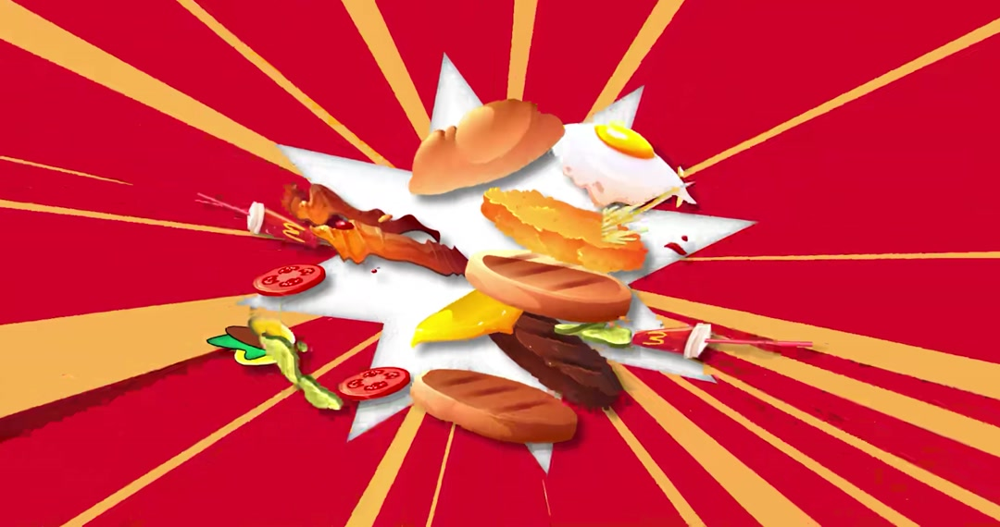 | 0:10.5 | 0.5s | set the mood: Repeat the ingredient burst transi… | Same ingredient burst on sunburst as sho… | smooth move | — | code / template render 85% | rendered by the creator |
| 11 | 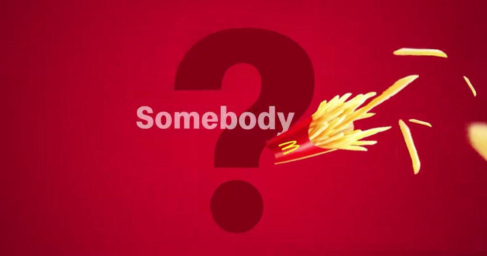 | 0:11.1 | 3.7s | add information: Second pass of the brand callou… | Repeat of shots 3+4 combined: 'Somebody … | smooth move | — | code / template render 85% | product photo, logo / brand mark |
| 12 |  | 0:14.7 | 0.7s | add information: Repeat cursor set-up | Same as shot 5: cursor on dark red, card… | smooth move | — | code / template render 93% | rendered by the creator |
| 13 |  | 0:15.4 | 1.4s | call to action: Repeat the Order Now click | Same as shot 6: cursor clicks the red 'O… | smooth move | — | code / template render 92% | rendered by the creator |
| 14 |  | 0:16.8 | 1.2s | deliver the conclusion: Repeat tagline | Same as shot 7: cartoon M fries box on s… | smooth move | — | code / template render 90% | rendered by the creator |
| 15 | 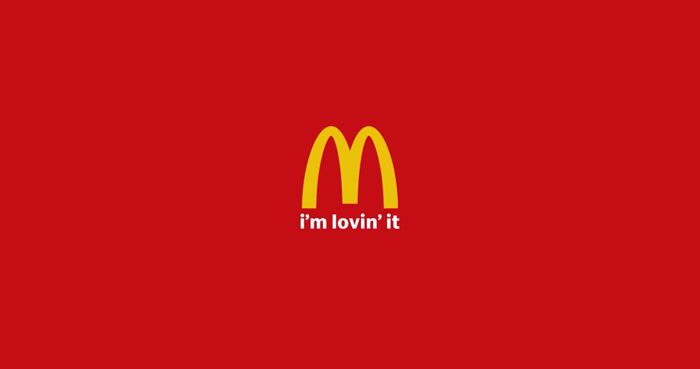 | 0:18.0 | 1.4s | deliver the conclusion: Repeat brand end card | Same McDonald's 'i'm lovin' it' red end … | whole-frame zoom / pan | — | code / template render 71% | logo / brand mark |
| 16 |  | 0:19.4 | 2.0s | call to action: Creator's signature logo sting t… | Hard cut to the creator's own logo: a ye… | static | — | code / template render 95% | rendered by the creator |

## Cast, scenes and props

| Id | Name | Kind | Look | Role | Voice | Shots |
|---|---|---|---|---|---|---|
| A | Happy Meal box | product | Red box with yellow Golden Arches handle on top and a yellow smile on the front, glossy gradient shading | Opening hero object | — | #1, #9 |
| B | Burger line-up | product | Real McDonald's product photos: Daily Double, Double Quarter Pounder with Cheese, McDouble, Quarter Pounder with Cheese, Big Mac | Menu showcase | — | #1, #4, #11 |
| C | Cartoon M fries box | product | Yellow trapezoid fries box/bag with thick black outline and purple Golden Arches, flat cel shading | Tagline hero | — | #7, #14 |
| D | Creator mascot | cartoon character | Yellow line-art face of a boy with a side-swept fringe, one eye winking, small smile | Creator signature | — | #16 |

**Scenes**

| Scene | Where | When | Set / light | Shots |
|---|---|---|---|---|
| S1 | Dark crimson stage with round pedestal and two arch-shaped spotlights | — | Moody, warm glow | #1, #9 |
| S2 | Red/yellow comic sunburst | — | Rotating rays, white burst shape | #2, #7, #10, #14 |
| S3 | Deep red vignette backdrop with big question mark / UI cards | — | Dark red radial vignette | #3–#6, #11–#13 |
| S4 | Flat McDonald's red end card | — | Flat solid red | #8, #15, #16 |

**Props / products / logos**

- McDonald's logo / 'i'm lovin' it' (shots #4, #6, #8, #11, #15): Trademark, used in an unofficial spec ad
- Yellow arrow cursor + 'Order Now' button (shots #5, #6, #12, #13): Fake web UI used as the call to action
- Fries (shots #3, #11): Flying fries elements in the callout scene

## Camera and lighting

- Visual style: Bold flat motion graphics in McDonald's red and yellow, comic sunbursts and burst shapes, real product photos cut out and composited into UI cards, light 3D for the opener
- Framing: shot size medium close-up 100%; subject is the in-focus region (no face; shot size is an estimate)
- Camera: moving camera (gimbal / handheld pan) 94%, fixed camera (tripod / mount / on the desk) 6%; typical move push-in
- Lighting: Not live action. Stylised: warm yellow arch-shaped spotlight cones on dark crimson for the opener; flat lighting with soft drop shadows elsewhere (image reading; pixel measurements in the fold below)
- Grade: natural (close to the original colours); high saturation, normal contrast, normal blacks, overall warm

Per-item measurements and image readings (9)

| Aspect | Item | Verdict | Sources |
|---|---|---|---|
| Framing | shot size | medium close-up | measured |
| Camera | camera support | moving camera (gimbal / handheld pan) | measured |
| Camera | set-ups / locations | No camera: virtual 2D/3D comp camera only (push-ins, whip-pans, zooms through a card) | agent review |
| Camera | likely gear | Adobe After Effects (creator's hashtags #aftereffects #motiongraphics); opening stage likely AE 3D layers / Cinema 4D-style extrusion | agent review |
| Lighting | soft / hard | soft light (almost no lit / shadow edge) | measured |
| Lighting | colour temperature | warm (about 3000–4000K) | measured |
| Lighting | overall lighting | Not live action. Stylised: warm yellow arch-shaped spotlight cones on dark crimson for the opener; flat lighting with soft drop shadows elsewhere | agent review |
| Grade | colour grade | natural (close to the original colours) | measured |
| Grade | overall grade | Brand palette: McDonald's red (#C8102E-ish) and yellow (#FFC72C-ish), high saturation, dark-red vignettes behind cards | agent review |

- Note: lighting ratio, soft / hard, colour temperature and shot size are measured on the subject's pixels (the face when there is one, otherwise the in-focus region, which is an estimate); platform transcodes crush the shadows, so hardness and fill read conservative; camera angle, light source, catchlight and rim light follow the image readers. Where measurement and readers disagree, both are listed.

## Packaging layer (subtitles / styled text / stickers / sound-effect hits)

- No overlaid text or stickers detected
- Exports: `packaging/timeline.json` (SRT is the subtitle timeline; ASS carries colour, outline, position and entrance animation, swap in the original font; timeline.json is the full timeline)

Remake: burn subtitles and styled text in with `packaging/overlays.ass` (ffmpeg -vf ass=overlays.ass), or rebuild them from timeline.json in CapCut / Remotion; stickers and GIFs need matching assets (meme / GIF libraries), crops are under packaging/.

## Sound

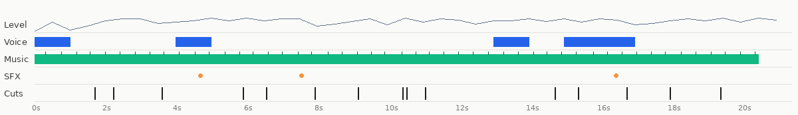

- loudness -15.0 dBFS, peak -3.0 dBFS; sound runs across cuts, laid in post as one bed (background changes 5.3dB at cuts vs 3.5dB within shots)
- Sources: Video type: voice-over / talking head + music → voice: TTS voice-over; music: stock library music (leaning, to confirm); SFX: added in post from an SFX library / editor (leaning, to confirm)

**Voice**

- 23% of the duration; pitch about 264.1Hz (female-leaning)
- Source: TTS voice-over (TTS voice-over 64%, human recording 27%, native dialogue from the AI video model 9%)
  - Voice and background sound run across cuts: the voice-over was laid on separately in post (TTS or a human voice-over)
- Remake: TTS voice-over: CapCut text-to-speech or another TTS tool, with a similar voice and pace

**Music**

- Tempo: 141.6 BPM (or 70.8/283.2); key F major (confidence 0.772); 95% of the duration (0.0–20.5s); section changes at 4.0s, 16.0s; ending: cut off hard
- Cuts vs beat: 33% of cuts land on a beat (chance: about 32%)
- Source: to confirm (stock library music 63%, well-known song 23%, AI-generated music 13%)
  - The music is a bed under the picture: in a regular video the bed usually comes from a stock library (prior)
  - The voice is speech / narration, not singing (sustained-pitch ratio 0.21): a regular "voice-over + music bed" video
  - The music is hard-cut at the end (still at full level when the video stops): typical of a trimmed existing track
  - Nothing about this track beyond the format prior and weak cues like the ending (no source heard, no platform music tag): source to confirm; an AI-generated bed cannot be told from a library bed here
  - How to confirm: Check the music tag on the original Douyin / Xiaohongshu / TikTok post: a song title → existing track; "original sound - @creator" → uploaded by the creator (for music videos, usually an AI song)
  - How to confirm: Run it through Shazam / ACRCloud or another song-ID service: a hit means an existing song
- Remake: The original track leans stock library music: search a library by BPM / mood / key for a similar track, or generate a royalty-free track in a similar style with AI

**Sound effects** (3)

| Sound | Listen | Type | Times used | At | On screen |
|---|---|---|---|---|---|
| F1 | [listen](sfx/sfx_01.wav) | pop | 1 | 4.7s | — |
| F2 | [listen](sfx/sfx_02.wav) | whoosh | 1 | 7.6s | — |
| F3 | [listen](sfx/sfx_03.wav) | whoosh | 1 | 16.5s | — |

- Remake: play each sound first (separated out, without voice or music), find one similar effect in the editor's library, and place it at every time listed under “At”

- Separated stems: `stems/original.wav` (original), `stems/vocals.wav` (dry voice), `stems/music.wav` (music + ambience), `stems/effects.wav` (effects track)
<!--stems-->

## Open questions

- Shot #4 (3.6–5.9s): photo / image: real material or generated, to confirm
- No AI listened to the soundtrack (the review covered the picture only): real voice versus TTS is inferred from the waveform; the effects were found on the separated effects track and their types are estimated from the sound. Play the stems and each effect under “Sound” to check
- music source to confirm: most likely stock library music (63%); how to check is under “Sound”

# Part two · Remake plan

> No video model chosen yet. How the AI shots are grouped, how long one call can be, whether the source can be fed as a reference and how prompts are written all differ by model, so this part is planned for the model you will use: tell the agent which model or platform (Seedance, Kling, Veo, Hailuo…); it looks the model up and runs `rea-video plan <folder> --model <model>` to fill this in.

## Remake it yourself: do it in this order

Copy the method and the rhythm, not the pictures: keep what each part does and fill it with your own content and material.

This is a motion-graphics explainer. Do the steps in this order; the detail for each is in the matching subsection below.

1. **Write the content**: write yours in the same 10 steps as the original (narrative line under “Content and structure”)
2. **Collect material**: the real material in the picture (logo / brand mark, product photo) needs the original files, listed under “What to prepare”
3. **Voice**: the original is TTS voice-over; record it yourself or use TTS
4. **Motion graphics**: have the agent run `rea-video code-remake` for an editable first version and change the text and pictures on top of it rather than starting from scratch; the first version is only a start, where it differs from the original is under “Code build”
5. **Music**: find a track at the same tempo and mood (source: to confirm, about 142 BPM, F major)
6. **Sound effects**: 3; place similar ones from a library at the times under “Sound”
7. **Put it together and compare**: hand the shots you made to the agent; `rea-video remake` places them on the original timeline, keeps the original where yours are missing, and renders a side-by-side comparison with the original

### What to prepare

- Real files shown in the picture (screenshots, photos, recordings; get the originals):
  - **product photo** (part of the frame): shots #4, #11, 6.0s in all
  - **logo / brand mark** (part of the frame): shots #4, #8, #11, #15, 8.7s in all

### Code build

Rebuild it as one project in an HTML video framework (such as HyperFrames or Remotion): cuts, transitions and each shot's key frames from "Rhythm and key frames", layout, colours and elements from the scenes below. Text and UI are 100% controllable, changing copy is a data change, and an AI coding assistant can write the project.

`rea-video code-remake <breakdown folder>` only makes a quick draft: it renders `code/remake.mp4` from each scene's sampled points / cut-out, motion and background glow and scores it. Particles, point clouds and data visualisations on a dark ground come close; an illustrated character's acting and morph transitions do not.

- Part 1: shots #2–#8 (1.7–10.4s)
- Part 2: shots #10–#16 (10.5–21.4s)

Remake assets (all in the report folder; hand them over together with the data below to whoever writes the code, or to an LLM):
- `shots/shot_XXX_first.jpg` / `_last.jpg`: first / last frame of each shot at full size, for layout, type size and margins
- `shots/shot_XXX_strip.jpg`: key frames about every 0.5 s, to follow the animation
- `shots/shot_XXX_elements.jpg` and `_el_NN.jpg` / `_st_NN.jpg` / `_ly_NN.jpg`: full-size crop of every element once settled, numbered as in the motion timeline; redraw shapes from them, cut out icons, logos and illustrations that cannot be redrawn
- `packaging/overlays.ass`, `packaging/timeline.json`: timing, position and colour of the text

How to build the pictures (by the measured picture type):
- vector shapes: SVG shapes + interpolate() / spring() keyframes, positions and timing measured from the frame
- kinetic type: Word-by-word spring() entrances (offset + scale + opacity), highlight boxes on key words; match font, size and leading from the frame
- gradients / colour fields: CSS linear / radial gradients, or a few large circles with filter: blur() drifting slowly; glass cards with backdrop-filter
- procedural colour field: GLSL fragment shader (fractal / noise / plasma) via Three.js ShaderMaterial or a WebGL canvas, time passed as a uniform each frame

| Shot | Time | Build | Picture | Camera | Colours | On-screen text |
|---|---|---|---|---|---|---|
| #2 | 1.7–2.2s | vector shapes | Hard pop from the rising burger into a white star-shaped comic burst on a red/yellow sunburst. Burger ingredients and fries explode outward and spin, then the frame whip-pans right with motion blur into the red question-mark scene. | push in 69%/s, picture drifts left, rotates | red, orange | — |
| #3 | 2.2–3.6s | kinetic type | Deep red background with a large darker question mark. White 'Somebody say' animates in word by word, then 'McDonald's' in big bold yellow slides in under it, while golden fries and a large fry stick fly diagonally across the frame. At ~3.3s a dark rounded rectangle opens in the centre and grows into the yellow web card (zoom transition). | push in 12%/s, picture drifts left | ground #85011b · #bc0f29 #a20624 #f2d373 #eda528 · drawn #f4d570 #fae8d2 #f3b018 #e48d73 | Big |
| #4 | 3.6–5.9s | kinetic type | Yellow rounded web-page card with soft drop shadow on a dark red vignette background, nav bar and red M logo tile at top. The card zooms up to fill most of the frame, then the hero product swaps on beat: Daily Double -> Double Quarter Pounder with Cheese -> McDouble -> Pounder with Cheese -> Big Mac, each with large white stacked type on the right. Ends with the card scaling up and blurring out. | push in 6%/s, picture drifts up | ground #700619 · #f6c64e #efd192 #d5af66 #9b694d · drawn #f6c654 #e8be10 #efd49a #fdf9ee | with / Cheese / M / Our Menu / Dowload App / McDelive |
| #5 | 5.9–6.6s | gradients / colour fields | Empty dark red vignette with a large yellow arrow cursor in the centre; the Order Now card slides in diagonally from the top-left corner toward the cursor. | pull out 26%/s, picture drifts right | ground #6f0d12 · #851015 #f7c855 #efc413 · drawn #f9c751 #f8ce0c #ed8e10 #e7d7c4 | NOW |
| #6 | 6.6–7.9s | gradients / colour fields | Close-up of the yellow card with a large red pill button 'Order Now'. The yellow cursor enters bottom-right, moves onto the button and clicks; the button squashes, the card shrinks and the button flies to the centre with motion blur. | pull out 14%/s, picture drifts right | ground #6d0e13 · #eac010 #f6c751 #7e1317 #c02f1d · drawn #eac00a #f9c74f #f8e111 | — |
| #7 | 7.9–9.2s | kinetic type | Hard cut on the click to a big yellow cartoon McDonald's fries box/bag (black outline, purple Golden Arches) bouncing in the centre over spinning red and yellow sunburst rays. White bold text 'just' then 'eat' pops in under it on the beat. | static frame, elements move inside it | ground #6c1016 · #801214 #f6ce35 #eaab12 #99452a · drawn #f8cf2a #f0af0b #f9d873 | just eat / M / i'm lovin' it |
| #8 | 9.2–10.4s | procedural colour field | Flat McDonald's red end card, small yellow Golden Arches with 'i'm lovin' it' under it, centred, with a slow subtle scale. At the end the logo blurs/streaks down into the next loop. | push in 7%/s, picture drifts left | ground #c30f14 · #cd5319 #a92213 #961310 #7c1010 · drawn #ebb80e #db722a #7f0f10 #f5b5b9 | M / i'm lovin' it |
| #10 | 10.5–11.1s | kinetic type | Same ingredient burst on sunburst as shot 2, ending in the whip-pan. | push in 68%/s, picture drifts left, rotates | red, orange | Somebody / W |
| #11 | 11.1–14.7s | kinetic type | Repeat of shots 3+4 combined: 'Somebody say McDonald's' kinetic type with flying fries (11.07-12.3s), zoom into the yellow web card (12.3-12.6s), product carousel Big Mac -> Daily Double -> Double Quarter Pounder with Cheese -> McDouble -> Pounder with Cheese -> Big Mac, then defocus blur out. | push in 6%/s, picture drifts left | ground #710719 · #f4c64b #f0d791 #b28448 #8d5a3d · drawn #f5c555 #eab812 #f0d39d #fdf5ec | M / Our Menu / Dowload App / McDelivery / About Our Foo / About Our Food |
| #12 | 14.7–15.4s | gradients / colour fields | Same as shot 5: cursor on dark red, card slides in from top-left. | pull out 26%/s, picture drifts right, rotates | ground #6b0f12 · #831115 #8a1116 #781013 #f7c855 · drawn #f9c851 #f7ce0c #ed8e0f #e7d7c3 | r Now |
| #13 | 15.4–16.8s | gradients / colour fields | Same as shot 6: cursor clicks the red 'Order Now' button. | pull out 15%/s, picture drifts right | ground #6d0e13 · #eac010 #f6c751 #7e1317 #c02f1d · drawn #ecc40b #f8c74f | Order Now |
| #14 | 16.8–18.0s | kinetic type | Same as shot 7: cartoon M fries box on sunburst, 'just eat'. | static frame, elements move inside it | ground #6c1016 · #801214 #f5cd2d #eaab18 #99452a · drawn #f7cb29 #eca80c #f6d270 | M |
| #15 | 18.0–19.4s | procedural colour field | Same McDonald's 'i'm lovin' it' red end card as shot 8. | push in 7%/s, picture drifts left | ground #c21416 · #c30f11 · drawn #ebbc0d #eb8160 #facbcf #bb671b | M / i'm lovin' it |
| #16 | 19.4–21.4s | procedural colour field | Hard cut to the creator's own logo: a yellow line-art face of a boy with a side fringe, winking and smiling, centred on McDonald's red, held for 2s. | static | ground #c21413 · #c30f11 #e9bf0e · drawn #eabf0a #fc9a33 #d58007 #f26f2f | — |

**Picture scenes** (a new scene whenever what is drawn moves or changes shape as a whole inside a shot. `frames/` holds first / middle / last full-size frames per scene, `scene_XX_layer.png` the drawn layer of the middle frame (background and text removed, alpha by how strongly it stands out), `frames/points/scene_XX.json` samples of that layer, one `x y r g b a` per row with x, y in 0–1. Place particles, trace lines or redraw shapes from these instead of guessing from a description. `track` in `frames/scenes.json` follows the layer's centre and spread over time)

| Scene | Shot | Time | Ground | Background glow | Drawn colours | Pieces | Area (x0 y0 x1 y1) | Motion |
|---|---|---|---|---|---|---|---|---|
| scene_02 | #5 | 5.9–6.6s | #780f12 | #ecb93f, centre (0.18, 0.22), radius 0.16 | #f7c753 #eac20b | 5 | 0.01 0.01 0.35 0.43 | — |
| scene_03 | #6 | 6.6–7.9s | #821016 | #f9c84f, centre (0.39, 0.38), radius 0.34 | #ebc30a #f8c851 | 4 | 0.03 0.06 0.82 0.82 | pans (-4.8%, -4.3%)/s, points wander |
| scene_05 | #12 | 14.7–15.4s | #780f12 | #edba3f, centre (0.17, 0.20), radius 0.15 | #f9c851 #ebbd0c #ebdec0 | 3 | 0.01 0.03 0.45 0.40 | zoom out 18%/s, turns anticlockwise 10.1°/s, pans (+4.6%, +11.0%)/s |
| scene_06 | #13 | 15.4–16.8s | #821015 | #f9c84f, centre (0.39, 0.38), radius 0.34 | #ebc30a #f8c851 | 7 | 0.03 0.06 0.82 0.82 | zoom out 5%/s, turns clockwise 4.8°/s, pans (-3.4%, -5.6%)/s |
| scene_07 | #16 | 19.4–21.4s | #c50d15 | #d76410, centre (0.52, 0.43), radius 0.08 | #eac20a #f3a91f | 7 | 0.42 0.33 0.58 0.54 | near still |

When built, score it with `rea-video compare original remake --scenes frames/scenes.json -o dir` (each side's drawn layer is taken against its own ground, so a new ground colour still compares) and fix the lowest-scoring scenes first, from `compare_worst.jpg`.

Per-shot motion timeline (measured: positions in % of frame width / height, colours sampled once the element settles; read together with the key-frame strip)

Motion #2 1.7–2.2s · 0 events

- No element motion measured (still picture or only slight changes)

Motion #3 2.2–3.6s (whip pan in) · 1 events

- Ground #85011b; other main colours #bc0f29 #a20624 #f2d373 #eda528; drawn layer #f4d570 #fae8d2 #f3b018 #e48d73
Element crops (numbers match the motion list below; L = the continuously moving layer mid-shot and at the end, S = elements that never move), full-size files in `shots/`:

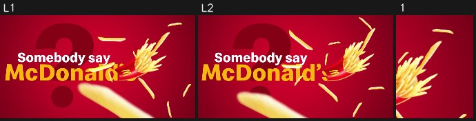

- [crop L1](shots/shot_003_ly_01.jpg) [crop L2](shots/shot_003_ly_02.jpg) · Continuous layer: 45% of the frame moves through the whole shot (x 4%–100%, y 4%–100%), e.g. drifting gradients, particle flow, breathing glow
1. 2.30–2.97s · middle right (x 73%–100%, y 0%–70%) · changes, moves leftward, ease-out · #91001e · [crop](shots/shot_003_el_01.jpg)

Motion #4 3.6–5.9s (zoom in) · 0 events

- Ground #700619; other main colours #f6c64e #efd192 #d5af66 #9b694d; drawn layer #f6c654 #e8be10 #efd49a #fdf9ee
Element crops (numbers match the motion list below; L = the continuously moving layer mid-shot and at the end, S = elements that never move), full-size files in `shots/`:

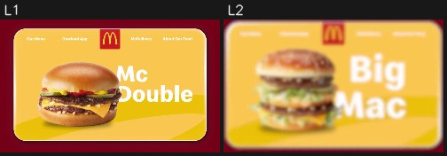

- [crop L1](shots/shot_004_ly_01.jpg) [crop L2](shots/shot_004_ly_02.jpg) · Continuous layer: 51% of the frame moves through the whole shot (x 9%–91%, y 4%–100%), e.g. drifting gradients, particle flow, breathing glow

Motion #5 5.9–6.6s (blur in) · 0 events

- Ground #6f0d12; other main colours #851015 #f7c855 #efc413; drawn layer #f9c751 #f8ce0c #ed8e10 #e7d7c4
Element crops (numbers match the motion list below; L = the continuously moving layer mid-shot and at the end, S = elements that never move), full-size files in `shots/`:

- [crop L1](shots/shot_005_ly_01.jpg) [crop L2](shots/shot_005_ly_02.jpg) · Continuous layer: 6% of the frame moves through the whole shot (x 0%–56%, y 0%–70%), e.g. drifting gradients, particle flow, breathing glow

Motion #6 6.6–7.9s · 0 events

- Ground #6d0e13; other main colours #eac010 #f6c751 #7e1317 #c02f1d; drawn layer #eac00a #f9c74f #f8e111
Element crops (numbers match the motion list below; L = the continuously moving layer mid-shot and at the end, S = elements that never move), full-size files in `shots/`:

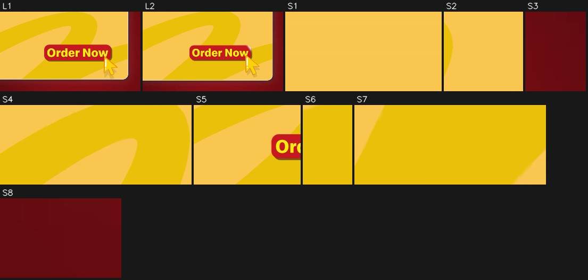

- S1. never moves: shape / text block · x 0%–9%, y 0%–8% · #f9c74f · [crop](shots/shot_006_st_01.jpg)
- S2. never moves: shape / text block · x 62%–80%, y 0%–38% · #f9c74f · [crop](shots/shot_006_st_02.jpg)
- S3. never moves: shape / text block · x 93%–100%, y 0%–19% · #640a0f · [crop](shots/shot_006_st_03.jpg)
- S4. never moves: shape / text block · x 0%–62%, y 4%–34% · #eac00a · [crop](shots/shot_006_st_04.jpg)
- S5. never moves: shape / text block · x 0%–40%, y 21%–77% · #f9c74f · [crop](shots/shot_006_st_05.jpg)
- S6. never moves: shape / text block · x 78%–80%, y 43%–55% · #eac00a · [crop](shots/shot_006_st_06.jpg)
- S7. never moves: shape / text block · x 20%–64%, y 64%–77% · #eac00a · [crop](shots/shot_006_st_07.jpg)
- S8. never moves: shape / text block · x 0%–5%, y 94%–100% · #630a0f · [crop](shots/shot_006_st_08.jpg)
- [crop L1](shots/shot_006_ly_01.jpg) [crop L2](shots/shot_006_ly_02.jpg) · Continuous layer: 36% of the frame moves through the whole shot (x 0%–89%, y 0%–96%), e.g. drifting gradients, particle flow, breathing glow

Motion #7 7.9–9.2s (zoom in) · 2 events

- Ground #6c1016; other main colours #801214 #f6ce35 #eaab12 #99452a; drawn layer #f8cf2a #f0af0b #f9d873
Element crops (numbers match the motion list below; L = the continuously moving layer mid-shot and at the end, S = elements that never move), full-size files in `shots/`:

- [crop L1](shots/shot_007_ly_01.jpg) [crop L2](shots/shot_007_ly_02.jpg) · Continuous layer: 61% of the frame moves through the whole shot (x 0%–100%, y 0%–91%), e.g. drifting gradients, particle flow, breathing glow
1. 8.00–8.80s · middle right (x 64%–76%, y 35%–56%) · changes, moves downward, ease-out · #881015 · [crop](shots/shot_007_el_01.jpg)
2. 8.07–8.33s · bottom right (x 60%–100%, y 74%–100%) · changes, moves downward, ease-out · #f7ca28 · [crop](shots/shot_007_el_02.jpg)

Motion #8 9.2–10.4s · 0 events

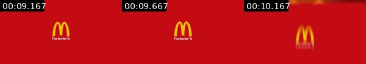

- Ground #c30f14; other main colours #cd5319 #a92213 #961310 #7c1010; drawn layer #ebb80e #db722a #7f0f10 #f5b5b9
Element crops (numbers match the motion list below; L = the continuously moving layer mid-shot and at the end, S = elements that never move), full-size files in `shots/`:

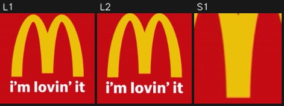

- S1. never moves: shape / text block · x 47%–53%, y 42%–55% · #eac00a · [crop](shots/shot_008_st_01.jpg)
- [crop L1](shots/shot_008_ly_01.jpg) [crop L2](shots/shot_008_ly_02.jpg) · Continuous layer: 4% of the frame moves through the whole shot (x 42%–58%, y 35%–65%), e.g. drifting gradients, particle flow, breathing glow

Motion #10 10.5–11.1s · 0 events

- No element motion measured (still picture or only slight changes)

Motion #11 11.1–14.7s (whip pan in) · 1 events

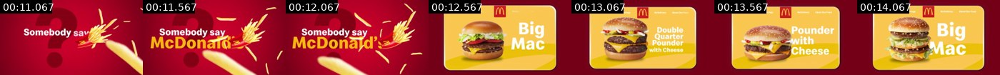

- Ground #710719; other main colours #f4c64b #f0d791 #b28448 #8d5a3d; drawn layer #f5c555 #eab812 #f0d39d #fdf5ec
Element crops (numbers match the motion list below; L = the continuously moving layer mid-shot and at the end, S = elements that never move), full-size files in `shots/`:

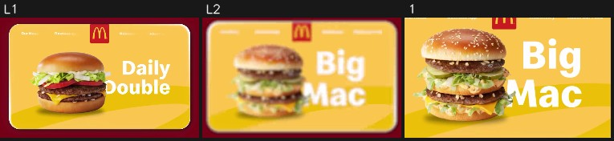

- [crop L1](shots/shot_011_ly_01.jpg) [crop L2](shots/shot_011_ly_02.jpg) · Continuous layer: 59% of the frame moves through the whole shot (x 9%–91%, y 4%–100%), e.g. drifting gradients, particle flow, breathing glow
1. 13.67–14.13s · middle (x 18%–84%, y 17%–91%) · changes, moves rightward, ease-in-out · #e4c04f · text “Somebody say / McDonalc / McDonard'” · [crop](shots/shot_011_el_01.jpg)

Motion #12 14.7–15.4s (blur in) · 0 events

- Ground #6b0f12; other main colours #831115 #8a1116 #781013 #f7c855; drawn layer #f9c851 #f7ce0c #ed8e0f #e7d7c3
Element crops (numbers match the motion list below; L = the continuously moving layer mid-shot and at the end, S = elements that never move), full-size files in `shots/`:

- [crop L1](shots/shot_012_ly_01.jpg) [crop L2](shots/shot_012_ly_02.jpg) · Continuous layer: 6% of the frame moves through the whole shot (x 0%–56%, y 0%–70%), e.g. drifting gradients, particle flow, breathing glow

Motion #13 15.4–16.8s · 0 events

- Ground #6d0e13; other main colours #eac010 #f6c751 #7e1317 #c02f1d; drawn layer #ecc40b #f8c74f
Element crops (numbers match the motion list below; L = the continuously moving layer mid-shot and at the end, S = elements that never move), full-size files in `shots/`:

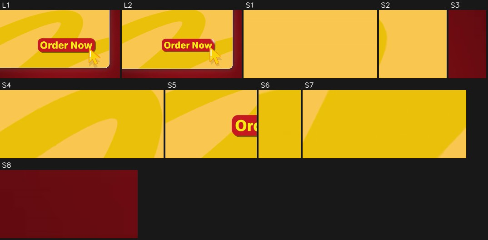

- S1. never moves: shape / text block · x 0%–9%, y 0%–8% · #f9c74f · [crop](shots/shot_013_st_01.jpg)
- S2. never moves: shape / text block · x 62%–80%, y 0%–38% · #f9c74f · [crop](shots/shot_013_st_02.jpg)
- S3. never moves: shape / text block · x 93%–100%, y 0%–27% · #630a0f · [crop](shots/shot_013_st_03.jpg)
- S4. never moves: shape / text block · x 0%–62%, y 4%–34% · #eac00a · [crop](shots/shot_013_st_04.jpg)
- S5. never moves: shape / text block · x 0%–40%, y 21%–77% · #f9c74f · [crop](shots/shot_013_st_05.jpg)
- S6. never moves: shape / text block · x 78%–80%, y 43%–55% · #eac00a · [crop](shots/shot_013_st_06.jpg)
- S7. never moves: shape / text block · x 20%–64%, y 64%–77% · #eac00a · [crop](shots/shot_013_st_07.jpg)
- S8. never moves: shape / text block · x 0%–7%, y 94%–100% · #630a0f · [crop](shots/shot_013_st_08.jpg)
- [crop L1](shots/shot_013_ly_01.jpg) [crop L2](shots/shot_013_ly_02.jpg) · Continuous layer: 36% of the frame moves through the whole shot (x 0%–89%, y 0%–96%), e.g. drifting gradients, particle flow, breathing glow

Motion #14 16.8–18.0s · 2 events

- Ground #6c1016; other main colours #801214 #f5cd2d #eaab18 #99452a; drawn layer #f7cb29 #eca80c #f6d270
Element crops (numbers match the motion list below; L = the continuously moving layer mid-shot and at the end, S = elements that never move), full-size files in `shots/`:

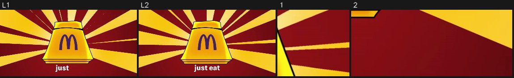

- [crop L1](shots/shot_014_ly_01.jpg) [crop L2](shots/shot_014_ly_02.jpg) · Continuous layer: 61% of the frame moves through the whole shot (x 0%–100%, y 0%–91%), e.g. drifting gradients, particle flow, breathing glow
1. 16.83–17.63s · middle right (x 64%–76%, y 35%–56%) · changes, moves downward, ease-out · #881015 · [crop](shots/shot_014_el_01.jpg)
2. 16.90–17.17s · bottom right (x 60%–100%, y 74%–100%) · changes, moves downward, ease-out · #f7ca26 · [crop](shots/shot_014_el_02.jpg)

Motion #15 18.0–19.4s · 0 events

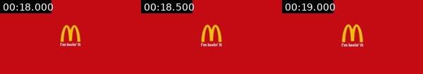

- Ground #c21416; other main colours #c30f11; drawn layer #ebbc0d #eb8160 #facbcf #bb671b
Element crops (numbers match the motion list below; L = the continuously moving layer mid-shot and at the end, S = elements that never move), full-size files in `shots/`:

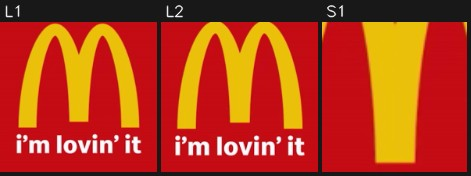

- S1. never moves: shape / text block · x 47%–53%, y 42%–55% · #eac008 · [crop](shots/shot_015_st_01.jpg)
- [crop L1](shots/shot_015_ly_01.jpg) [crop L2](shots/shot_015_ly_02.jpg) · Continuous layer: 4% of the frame moves through the whole shot (x 42%–58%, y 35%–65%), e.g. drifting gradients, particle flow, breathing glow

Motion #16 19.4–21.4s · 1 events

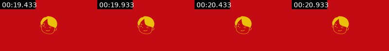

- Ground #c21413; other main colours #c30f11 #e9bf0e; drawn layer #eabf0a #fc9a33 #d58007 #f26f2f
Element crops (numbers match the motion list below; L = the continuously moving layer mid-shot and at the end, S = elements that never move), full-size files in `shots/`:

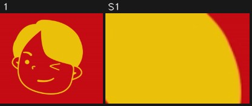

- S1. never moves: shape / text block · x 51%–58%, y 38%–47% · #eac00a · [crop](shots/shot_016_st_01.jpg)
1. 19.50–19.77s · middle (x 40%–62%, y 30%–70%) · changes, ease-out · #ce3f12 · [crop](shots/shot_016_el_01.jpg)

### Edit

- Cut in the order and lengths of the shot list
- Approach: ~42 cuts/min (1.3s average). Hard cuts land on the music's hook beats; whip-pan, zoom-through-card and click-to-cut transitions. The ~9.3s ad is played twice (second pass reorders the carousel) and closes with a 2s creator logo
- Rhythm: 42.0 cuts per minute, 1.34s average shot; no live-action shots; transitions blur transition×2, cut×7, transition effect×2, whip pan×2, zoom transition×2

**Transitions**

| Time | Into shot | Transition |
|---|---|---|
| 1.6–1.7s | #2 | transition effect, a few frames |
| 2.2–2.3s | #3 | whip pan, a few frames |
| 3.5–3.7s | #4 | zoom transition, 0.2s |
| 5.8–6.2s | #5 | blur transition, 0.4s |
| 7.9–8.2s | #7 | zoom transition, 0.3s |
| 10.5–10.5s | #10 | transition effect, a few frames |
| 11.0–11.1s | #11 | whip pan, a few frames |
| 14.6–15.0s | #12 | blur transition, 0.5s |

## Appendix

### Shot by shot

Each shot has two parts: what is visible on screen, and how the tools infer it was made (with the basis); remake prompts last. Folded by default.

#1 00:00.000–00:01.700 · 3D render + code / editor overlays (text labels)

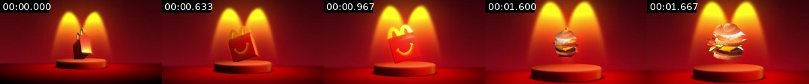

**Visible on screen** (check against the frames)
- Picture: Dark red stage, two warm yellow spotlight cones shaped like the Golden Arches. A red Happy Meal box with the yellow arches handle and smile turns from side-on to front on a round red pedestal (0-0.9s), tips back, and a burger cut-out pops up out of it and rises (1.2-1.7s). Slow push-in. Built as 3D layers (After Effects 3D / Cinema 4D-style extrusion) with glow.
- Camera / lighting: medium close-up; moving camera (gimbal / handheld pan); night / low-light ambient, no dedicated fill; key light frontal (from the camera side; both sides of the subject about equally bright); lighting ratio about 1.1:1 (0.1 stops); soft light (almost no lit / shadow edge)
- Text track (text/middle): M
- [AI assistant review] Simple extruded box with clean gradient material rotating in true 3D perspective on a cylinder pedestal
- [AI assistant review] Two volumetric spotlight cones form the shape of the Golden Arches; light falloff is perfectly smooth, no texture boiling or deformation
- [AI assistant review] Burger rising out of the box is a flat photo cut-out composited in, not modelled

**How it was made, as inferred by the tools** (inferred, not seen)
- Inference: 3D render 51%, code / template render 33%, AI-generated video 3% (fused_agent)
- Material: rendered by the creator
- Basis (tool measurements, not necessarily visible to the eye):
  - The picture is procedural rainbow colour fields (fractal / shader) with almost no material texture (17% fine-texture pixels; footage, AI and 3D renders keep fabric / skin / noise texture): vector / gradient graphics drawn by code
  - Rendered texture: 23% flat colour blocks, 95% of pixels use only 79 colours, 19% axis-aligned edges
  - Platform transcode (Douyin/TikTok) has compressed the sensor noise away: noise cues no longer apply, live action vs AI rests on frame rate and picture content

- Remake: 3D render: a video model gives an approximation (see the generation units); for precise multiple angles, model in 3D and render in Blender
  - Shot description (from the review; the generation prompts start from it): Centered medium shot, slow push-in. A red Happy Meal box on a round pedestal rotates from side view to front view under two arch-shaped yellow spotlights, tilts back, and a cheeseburger pops out and rises above the box, glowing.

#2 00:01.700–00:02.233 · code / template render

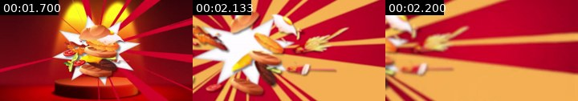

**Visible on screen** (check against the frames)
- Picture: Hard pop from the rising burger into a white star-shaped comic burst on a red/yellow sunburst. Burger ingredients and fries explode outward and spin, then the frame whip-pans right with motion blur into the red question-mark scene.
- [AI assistant review] Illustrated cut-out food elements (bun, patties, bacon, egg, tomato, lettuce, fries, branded drink cups) fly outward from a white comic 'POW' burst
- [AI assistant review] Flat red/yellow sunburst rays background, motion-blurred elements: typical After Effects MG
- [AI assistant review] Ends in a fast whip-pan with streaks to the next scene

**How it was made, as inferred by the tools** (inferred, not seen)
- Inference: code / template render 45%, 2D animation 32%, 3D render 9% (fused_agent)
- Material: rendered by the creator
- Basis (tool measurements, not necessarily visible to the eye):
  - Platform transcode (Douyin/TikTok) has compressed the sensor noise away: noise cues no longer apply, live action vs AI rests on frame rate and picture content

- Remake: Code render: rebuild in an HTML video framework (such as HyperFrames or Remotion) from the rhythm, key frames and layout, 100% controllable, no generative model needed

#3 00:02.233–00:03.600 · code / template render

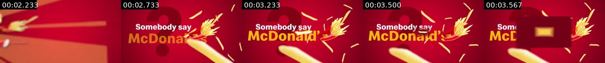

**Visible on screen** (check against the frames)
- Picture: Deep red background with a large darker question mark. White 'Somebody say' animates in word by word, then 'McDonald's' in big bold yellow slides in under it, while golden fries and a large fry stick fly diagonally across the frame. At ~3.3s a dark rounded rectangle opens in the centre and grows into the yellow web card (zoom transition).
- Text track (text in the picture/middle): Somebody say / Somebody șay
- Text track (text in the picture/middle): McDona / McDonard'
- Text track (text in the picture/middle): Big
- [AI assistant review] Flat kinetic typography: 'Somebody say' white, 'McDonald's' yellow, over a giant dark-red question mark
- [AI assistant review] Fries and a fry stick fly in with motion blur; text slides/types on

**How it was made, as inferred by the tools** (inferred, not seen)
- Inference: code / template render 67%, 3D render 16%, 2D animation 4% (fused_agent)
- Material: rendered by the creator
- Basis (tool measurements, not necessarily visible to the eye):
  - Platform transcode (Douyin/TikTok) has compressed the sensor noise away: noise cues no longer apply, live action vs AI rests on frame rate and picture content

- Remake: Code render: rebuild in an HTML video framework (such as HyperFrames or Remotion) from the rhythm, key frames and layout, 100% controllable, no generative model needed

#4 00:03.600–00:05.900 · code / template render; brings in real material (product photo, logo / brand mark)

**Visible on screen** (check against the frames)
- Picture: Yellow rounded web-page card with soft drop shadow on a dark red vignette background, nav bar and red M logo tile at top. The card zooms up to fill most of the frame, then the hero product swaps on beat: Daily Double -> Double Quarter Pounder with Cheese -> McDouble -> Pounder with Cheese -> Big Mac, each with large white stacked type on the right. Ends with the card scaling up and blurring out.
- Text track (text in the picture/middle): Daily / Mc / Pounder / Big
- Text track (text in the picture/middle): Jouble / Double / Mac
- Text track (text in the picture/middle): with
- Text track (text in the picture/middle): Cheese
- [AI assistant review] A designed UI card (rounded yellow panel, nav bar 'Our Menu / Dowload App / McDelivery / About Our Food' with the M logo) - a mock-up, not a real screen recording (note the typo 'Dowload')
- [AI assistant review] Real product photos swap every ~0.35-0.5s with bold white names; card ends with a defocus blur

**How it was made, as inferred by the tools** (inferred, not seen)
- Inference: code / template render 66%, 3D render 11%, 2D animation 6% (fused_agent)
- Material: mixed (includes real material): product photo, logo / brand mark; real or not, to confirm: photo / image
- Basis (tool measurements, not necessarily visible to the eye):
  - Rendered texture: 44% flat colour blocks, 95% of pixels use only 164 colours, 37% axis-aligned edges
  - Platform transcode (Douyin/TikTok) has compressed the sensor noise away: noise cues no longer apply, live action vs AI rests on frame rate and picture content

- Remake: Code render: rebuild in an HTML video framework (such as HyperFrames or Remotion) from the rhythm, key frames and layout, 100% controllable, no generative model needed; real material the user must supply: product photo (part of the frame), logo / brand mark (part of the frame)

#5 00:05.900–00:06.567 · code / template render

**Visible on screen** (check against the frames)
- Picture: Empty dark red vignette with a large yellow arrow cursor in the centre; the Order Now card slides in diagonally from the top-left corner toward the cursor.
- Text track (text in the picture/middle): 4 / Order Now
- Text track (text in the picture/top): NOW
- [AI assistant review] Stylised yellow 3D-ish arrow cursor on flat dark red; card corner slides in from top-left - animated, not a real capture

**How it was made, as inferred by the tools** (inferred, not seen)
- Inference: code / template render 87%, 3D render 3%, screen recording / screenshot 3% (fused_agent)
- Material: rendered by the creator
- Basis (tool measurements, not necessarily visible to the eye):
  - The picture is large saturated colour fields with almost no material texture (4% fine-texture pixels; footage, AI and 3D renders keep fabric / skin / noise texture): vector / gradient graphics drawn by code
  - Rendered texture: 73% flat colour blocks, 95% of pixels use only 12 colours, 52% axis-aligned edges
  - Platform transcode (Douyin/TikTok) has compressed the sensor noise away: noise cues no longer apply, live action vs AI rests on frame rate and picture content

- Remake: Code render: rebuild in an HTML video framework (such as HyperFrames or Remotion) from the rhythm, key frames and layout, 100% controllable, no generative model needed

#6 00:06.567–00:07.933 · code / template render

**Visible on screen** (check against the frames)
- Picture: Close-up of the yellow card with a large red pill button 'Order Now'. The yellow cursor enters bottom-right, moves onto the button and clicks; the button squashes, the card shrinks and the button flies to the centre with motion blur.
- Text track (text in the picture/middle): Order Now / Order Naw
- [AI assistant review] Flat yellow card with soft swoosh pattern, red pill button with yellow 'Order Now' text; cursor glides in and clicks

**How it was made, as inferred by the tools** (inferred, not seen)
- Inference: code / template render 85%, 3D render 5%, screen recording / screenshot 3% (fused_agent)
- Material: rendered by the creator
- Basis (tool measurements, not necessarily visible to the eye):
  - The picture is large saturated colour fields with almost no material texture (11% fine-texture pixels; footage, AI and 3D renders keep fabric / skin / noise texture): vector / gradient graphics drawn by code
  - Rendered texture: 65% flat colour blocks, 95% of pixels use only 25 colours, 60% axis-aligned edges
  - Platform transcode (Douyin/TikTok) has compressed the sensor noise away: noise cues no longer apply, live action vs AI rests on frame rate and picture content

- Remake: Code render: rebuild in an HTML video framework (such as HyperFrames or Remotion) from the rhythm, key frames and layout, 100% controllable, no generative model needed

#7 00:07.933–00:09.167 · code / template render

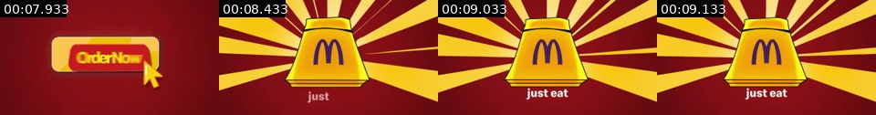

**Visible on screen** (check against the frames)
- Picture: Hard cut on the click to a big yellow cartoon McDonald's fries box/bag (black outline, purple Golden Arches) bouncing in the centre over spinning red and yellow sunburst rays. White bold text 'just' then 'eat' pops in under it on the beat.
- Text track (text in the picture/bottom): just eat
- Text track (text in the picture/middle): M
- Text track (text in the picture/middle): i'm lovin' it
- [AI assistant review] Cartoon fry-box/bag with thick black outline and purple M, flat cel shading, on rotating red/yellow sunburst rays
- [AI assistant review] Text 'just' then 'eat' pops in word by word

**How it was made, as inferred by the tools** (inferred, not seen)
- Inference: code / template render 61%, 2D animation 23%, 3D render 6% (fused_agent)
- Material: rendered by the creator
- Basis (tool measurements, not necessarily visible to the eye):
  - Rendered texture: 44% flat colour blocks, 95% of pixels use only 49 colours, 26% axis-aligned edges
  - Platform transcode (Douyin/TikTok) has compressed the sensor noise away: noise cues no longer apply, live action vs AI rests on frame rate and picture content

- Remake: Code render: rebuild in an HTML video framework (such as HyperFrames or Remotion) from the rhythm, key frames and layout, 100% controllable, no generative model needed

#8 00:09.167–00:10.433 · code / template render; brings in real material (logo / brand mark)

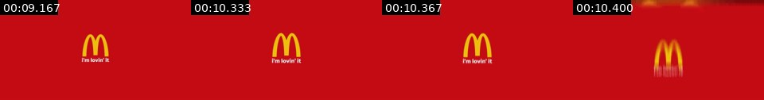

**Visible on screen** (check against the frames)
- Picture: Flat McDonald's red end card, small yellow Golden Arches with 'i'm lovin' it' under it, centred, with a slow subtle scale. At the end the logo blurs/streaks down into the next loop.
- Text track (text in the picture/middle): M
- Text track (text in the picture/middle): i'm lovin' it
- [AI assistant review] Flat red background with small centred yellow M and 'i'm lovin' it' wordmark, slight scale only

**How it was made, as inferred by the tools** (inferred, not seen)
- Inference: code / template render 37%, 2D animation 22%, still image + pan/zoom 14% (fused_agent)
- Material: mixed (includes real material): logo / brand mark
- Basis (tool measurements, not necessarily visible to the eye):
  - Whole frame moves as one rigid transform (100% inliers, 0.01px residual, no local motion) → pan/zoom on a still image: zoom +7.4%/s, pan 20px/s
  - The picture is procedural rainbow colour fields (fractal / shader) with almost no material texture (1% fine-texture pixels; footage, AI and 3D renders keep fabric / skin / noise texture): vector / gradient graphics drawn by code
  - Rendered texture: 96% flat colour blocks, 95% of pixels use only 1 colours, 24% axis-aligned edges
  - 99% of background pixels never change frame to frame while local elements move: 2D compositing / code-driven motion graphics
  - Platform transcode (Douyin/TikTok) has compressed the sensor noise away: noise cues no longer apply, live action vs AI rests on frame rate and picture content

- Remake: Code render: rebuild in an HTML video framework (such as HyperFrames or Remotion) from the rhythm, key frames and layout, 100% controllable, no generative model needed; real material the user must supply: logo / brand mark (part of the frame)

#9 00:10.433–00:10.533 · 3D render

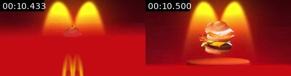

**Visible on screen** (check against the frames)
- Picture: 3-frame flash of the opening spotlight stage with the burger rising, used as the bridge into the second loop.
- Camera / lighting: medium close-up; fixed camera (tripod / mount / on the desk); coloured ambient light (RGB lights / neon); key light frontal (from the camera side; both sides of the subject about equally bright); lighting ratio about 1.0:1 (0.0 stops); soft light (almost no lit / shadow edge)
- [AI assistant review] Three-frame flash of the shot 1 stage (spotlights, pedestal, rising burger) with motion blur

**How it was made, as inferred by the tools** (inferred, not seen)
- Inference: 3D render 50%, code / template render 35%, AI-generated video 3% (fused_agent)
- Material: rendered by the creator
- Basis (tool measurements, not necessarily visible to the eye):
  - The picture is procedural rainbow colour fields (fractal / shader) with almost no material texture (19% fine-texture pixels; footage, AI and 3D renders keep fabric / skin / noise texture): vector / gradient graphics drawn by code
  - Rendered texture: 36% flat colour blocks, 95% of pixels use only 91 colours, 14% axis-aligned edges
  - Platform transcode (Douyin/TikTok) has compressed the sensor noise away: noise cues no longer apply, live action vs AI rests on frame rate and picture content

- Remake: 3D render: a video model gives an approximation (see the generation units); for precise multiple angles, model in 3D and render in Blender

#10 00:10.533–00:11.067 · code / template render

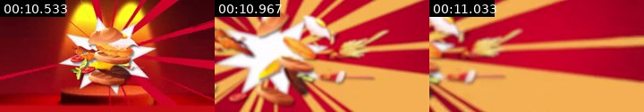

**Visible on screen** (check against the frames)
- Picture: Same ingredient burst on sunburst as shot 2, ending in the whip-pan.
- Text track (text in the picture/middle): Somebody
- Text track (text in the picture/middle): W
- [AI assistant review] Same illustrated ingredient burst and whip-pan as shot 2

**How it was made, as inferred by the tools** (inferred, not seen)
- Inference: code / template render 45%, 2D animation 32%, 3D render 9% (fused_agent)
- Material: rendered by the creator
- Basis (tool measurements, not necessarily visible to the eye):
  - Platform transcode (Douyin/TikTok) has compressed the sensor noise away: noise cues no longer apply, live action vs AI rests on frame rate and picture content

- Remake: Code render: rebuild in an HTML video framework (such as HyperFrames or Remotion) from the rhythm, key frames and layout, 100% controllable, no generative model needed

#11 00:11.067–00:14.733 · code / template render; brings in real material (product photo, logo / brand mark)

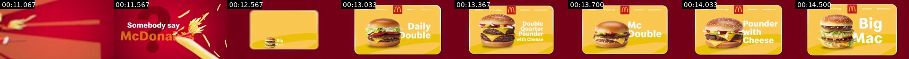

**Visible on screen** (check against the frames)
- Picture: Repeat of shots 3+4 combined: 'Somebody say McDonald's' kinetic type with flying fries (11.07-12.3s), zoom into the yellow web card (12.3-12.6s), product carousel Big Mac -> Daily Double -> Double Quarter Pounder with Cheese -> McDouble -> Pounder with Cheese -> Big Mac, then defocus blur out.
- Text track (text in the picture/middle): Somebody say / Big / Double / Quarter
- Text track (text in the picture/middle): McDonalc / McDonard' / Mac / Pounder
- Text track (text in the picture/middle): with Cheese / Mac
- Text track (text in the picture/top): M / Our Menu / Dowload App / McDelivery
- [AI assistant review] Same kinetic type 'Somebody say McDonald's' then zoom into the same web-card mock-up
- [AI assistant review] Carousel order differs: Big Mac first, then Daily Double, DQPC, McDouble, Pounder with Cheese, Big Mac
- [AI assistant review] This shot looks like several cuts merged; suggest splitting at 00:12.300 (code / template render→code / template render): Kinetic-type callout (= shot 3) zooms into the web card (= shot 4); joined by a zoom transition, so it is two beats

**How it was made, as inferred by the tools** (inferred, not seen)
- Inference: code / template render 68%, 3D render 11%, 2D animation 6% (fused_agent)
- Material: mixed (includes real material): product photo, logo / brand mark
- Basis (tool measurements, not necessarily visible to the eye):
  - Platform transcode (Douyin/TikTok) has compressed the sensor noise away: noise cues no longer apply, live action vs AI rests on frame rate and picture content

- Remake: Code render: rebuild in an HTML video framework (such as HyperFrames or Remotion) from the rhythm, key frames and layout, 100% controllable, no generative model needed; real material the user must supply: product photo (part of the frame), logo / brand mark (part of the frame)

#12 00:14.733–00:15.400 · code / template render

**Visible on screen** (check against the frames)
- Picture: Same as shot 5: cursor on dark red, card slides in from top-left.
- Text track (text in the picture/top): r Now
- [AI assistant review] Identical to shot 5

**How it was made, as inferred by the tools** (inferred, not seen)
- Inference: code / template render 87%, 3D render 3%, screen recording / screenshot 3% (fused_agent)
- Material: rendered by the creator
- Basis (tool measurements, not necessarily visible to the eye):
  - The picture is large saturated colour fields with almost no material texture (4% fine-texture pixels; footage, AI and 3D renders keep fabric / skin / noise texture): vector / gradient graphics drawn by code
  - Rendered texture: 75% flat colour blocks, 95% of pixels use only 12 colours, 52% axis-aligned edges
  - Platform transcode (Douyin/TikTok) has compressed the sensor noise away: noise cues no longer apply, live action vs AI rests on frame rate and picture content

- Remake: Code render: rebuild in an HTML video framework (such as HyperFrames or Remotion) from the rhythm, key frames and layout, 100% controllable, no generative model needed

#13 00:15.400–00:16.767 · code / template render

**Visible on screen** (check against the frames)
- Picture: Same as shot 6: cursor clicks the red 'Order Now' button.
- Text track (text in the picture/middle): Order Now
- [AI assistant review] Identical to shot 6

**How it was made, as inferred by the tools** (inferred, not seen)
- Inference: code / template render 85%, 3D render 5%, screen recording / screenshot 3% (fused_agent)
- Material: rendered by the creator
- Basis (tool measurements, not necessarily visible to the eye):
  - The picture is large saturated colour fields with almost no material texture (11% fine-texture pixels; footage, AI and 3D renders keep fabric / skin / noise texture): vector / gradient graphics drawn by code
  - Rendered texture: 64% flat colour blocks, 95% of pixels use only 25 colours, 60% axis-aligned edges
  - Platform transcode (Douyin/TikTok) has compressed the sensor noise away: noise cues no longer apply, live action vs AI rests on frame rate and picture content

- Remake: Code render: rebuild in an HTML video framework (such as HyperFrames or Remotion) from the rhythm, key frames and layout, 100% controllable, no generative model needed

#14 00:16.767–00:18.000 · code / template render

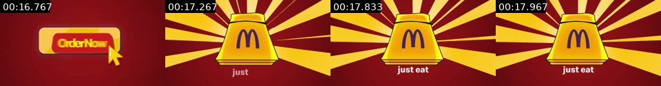

**Visible on screen** (check against the frames)
- Picture: Same as shot 7: cartoon M fries box on sunburst, 'just eat'.
- Text track (text in the picture/bottom): just / just eat
- Text track (text in the picture/middle): M
- [AI assistant review] Identical to shot 7

**How it was made, as inferred by the tools** (inferred, not seen)
- Inference: code / template render 61%, 2D animation 23%, 3D render 6% (fused_agent)
- Material: rendered by the creator
- Basis (tool measurements, not necessarily visible to the eye):
  - Rendered texture: 46% flat colour blocks, 95% of pixels use only 48 colours, 26% axis-aligned edges
  - Platform transcode (Douyin/TikTok) has compressed the sensor noise away: noise cues no longer apply, live action vs AI rests on frame rate and picture content

- Remake: Code render: rebuild in an HTML video framework (such as HyperFrames or Remotion) from the rhythm, key frames and layout, 100% controllable, no generative model needed

#15 00:18.000–00:19.433 · code / template render; brings in real material (logo / brand mark)

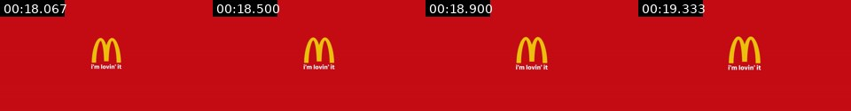

**Visible on screen** (check against the frames)
- Picture: Same McDonald's 'i'm lovin' it' red end card as shot 8.
- Text track (text in the picture/middle): M
- Text track (text in the picture/middle): i'm lovin' it
- [AI assistant review] Same end card as shot 8, held slightly longer

**How it was made, as inferred by the tools** (inferred, not seen)
- Inference: code / template render 37%, 2D animation 22%, still image + pan/zoom 14% (fused_agent)
- Material: mixed (includes real material): logo / brand mark
- Basis (tool measurements, not necessarily visible to the eye):
  - Whole frame moves as one rigid transform (100% inliers, 0.01px residual, no local motion) → pan/zoom on a still image: zoom +7.3%/s, pan 20px/s
  - The picture is procedural rainbow colour fields (fractal / shader) with almost no material texture (1% fine-texture pixels; footage, AI and 3D renders keep fabric / skin / noise texture): vector / gradient graphics drawn by code
  - Rendered texture: 96% flat colour blocks, 95% of pixels use only 1 colours, 24% axis-aligned edges
  - 99% of background pixels never change frame to frame while local elements move: 2D compositing / code-driven motion graphics
  - Platform transcode (Douyin/TikTok) has compressed the sensor noise away: noise cues no longer apply, live action vs AI rests on frame rate and picture content

- Remake: Code render: rebuild in an HTML video framework (such as HyperFrames or Remotion) from the rhythm, key frames and layout, 100% controllable, no generative model needed; real material the user must supply: logo / brand mark (part of the frame)

#16 00:19.433–00:21.433 · code / template render

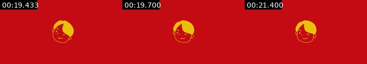

**Visible on screen** (check against the frames)
- Picture: Hard cut to the creator's own logo: a yellow line-art face of a boy with a side fringe, winking and smiling, centred on McDonald's red, held for 2s.
- [AI assistant review] Flat yellow line-art mascot face (boy with fringe, winking) on the same red; minimal motion

**How it was made, as inferred by the tools** (inferred, not seen)
- Inference: code / template render 76%, 2D animation 17%, 3D render 2% (fused_agent)
- Material: rendered by the creator
- Basis (tool measurements, not necessarily visible to the eye):
  - 89% of adjacent frames are exact duplicates, only local elements move (typical of template / motion-graphics animation, or a hold with local motion)
  - The picture is procedural rainbow colour fields (fractal / shader) with almost no material texture (2% fine-texture pixels; footage, AI and 3D renders keep fabric / skin / noise texture): vector / gradient graphics drawn by code
  - Rendered texture: 96% flat colour blocks, 95% of pixels use only 1 colours, 11% axis-aligned edges
  - 100% of background pixels never change frame to frame while local elements move: 2D compositing / code-driven motion graphics
  - Platform transcode (Douyin/TikTok) has compressed the sensor noise away: noise cues no longer apply, live action vs AI rests on frame rate and picture content

- Remake: Code render: rebuild in an HTML video framework (such as HyperFrames or Remotion) from the rhythm, key frames and layout, 100% controllable, no generative model needed

### Metadata clues

- Encoder: `Lavf58.76.100`
- platform: Douyin/TikTok

### Notes

- Deterministic forensics is reliable on motion, whole-frame pan/zoom, rendered texture and 24→30 fps conversion; telling live action from AI from 3D needs image reading (a VLM or an AI assistant's review), and a look at the frames yourself.
- Platform transcoding usually strips metadata; missing metadata proves nothing.
- The full data is in `breakdown.json`; the package for models starts at `VIDEO.md`.
